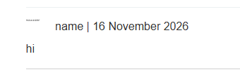
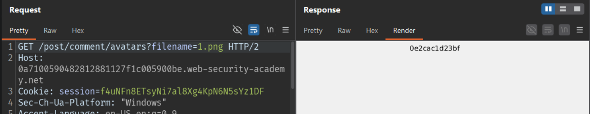
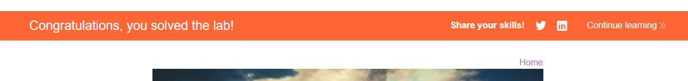

# Lab: Exploiting XXE via image file upload

## Mô tả lab

Ứng dụng cho phép người dùng upload avatar khi bình luận, và dùng thư viện Apache Batik để xử lý file ảnh. Mục tiêu là upload một ảnh hiển thị nội dung file `/etc/hostname`, sau đó submit giá trị hostname.

## Các bước thực hiện

Lần này ứng dụng là trang blog. Mỗi bài viết có form bình luận, trong đó có trường upload avatar.

Apache Batik là thư viện xử lý ảnh SVG. SVG là định dạng dựa trên XML, nên nếu server chấp nhận file SVG làm avatar thì toàn bộ tài liệu XML nằm trong tầm kiểm soát của mình, có thể thoải mái khai báo `DOCTYPE` và external entity.

Khác với các lab trước, ở đây không có chỗ nào echo dữ liệu dạng text. Tuy nhiên server sẽ render file SVG thành ảnh, nên nếu đặt entity vào phần tử `<text>`, nội dung file sẽ được "vẽ" luôn lên ảnh.

Tạo file SVG khai báo external entity trỏ tới `/etc/hostname` và hiển thị nó dưới dạng text:

```xml
<?xml version="1.0" standalone="yes"?>
<!DOCTYPE xxx [ <!ENTITY xxe SYSTEM "file:///etc/hostname"> ]>
<svg width="150px" height="50px" xmlns="http://www.w3.org/2000/svg" xmlns:xlink="http://www.w3.org/1999/xlink" version="1.1">
  <text font-size="16" x="0" y="16">&xxe;</text>
</svg>
```

Dùng file này làm avatar và đăng một bình luận. Bình luận hiển thị kèm một avatar rất nhỏ, khó đọc:



Avatar được lấy qua request `GET /post/comment/avatars?filename=1.png`. Để ý file trả về là `.png`, tức là server đã dùng Batik render SVG sang PNG, và entity đã được xử lý trong quá trình này. Mở ảnh sẽ đọc được nội dung `/etc/hostname`:



Submit giá trị hostname `0e2cac1d23bf`:



Lab solved.
